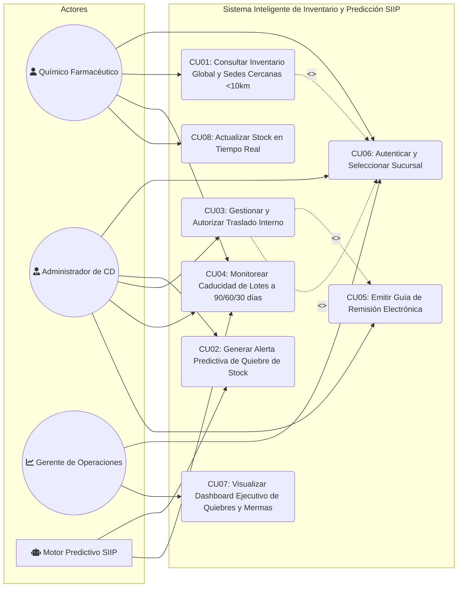
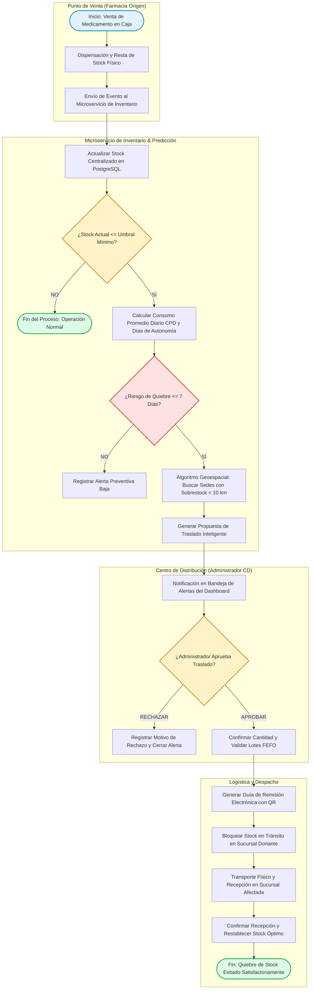
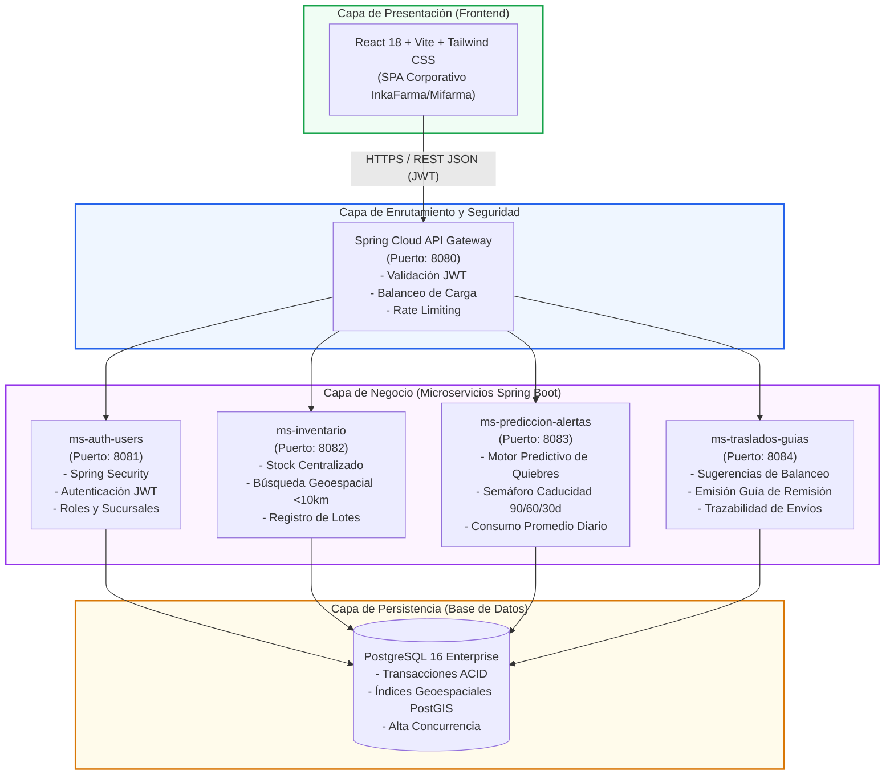
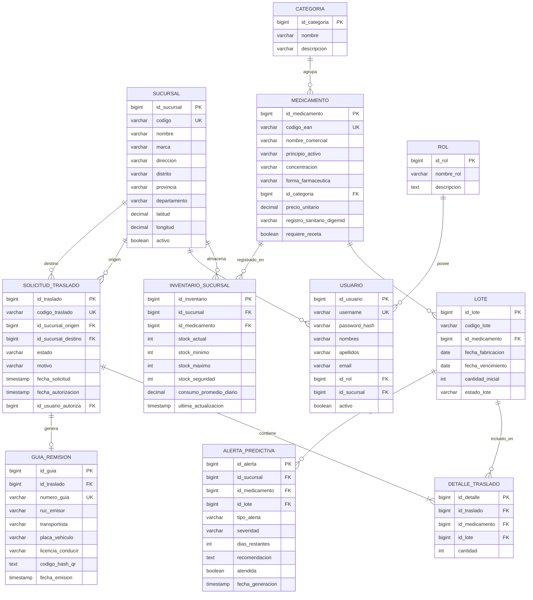
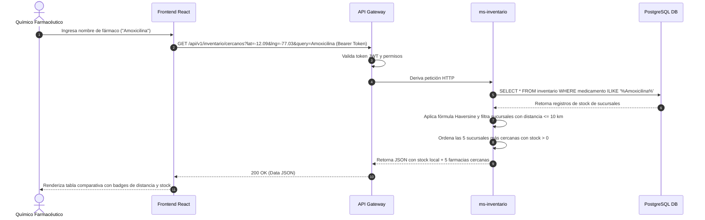
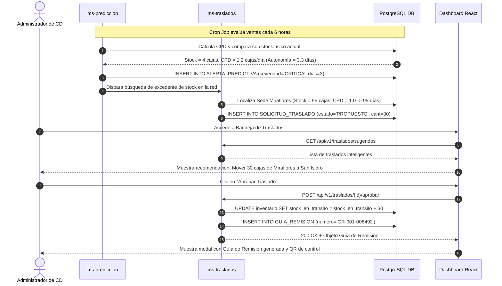
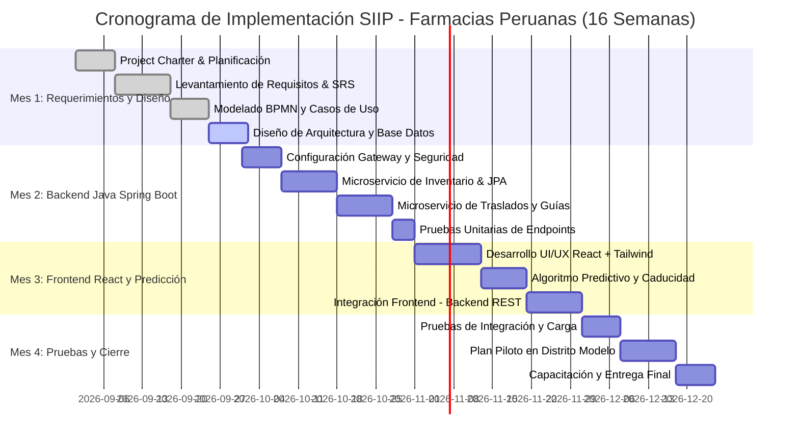

# SISTEMA INTELIGENTE DE INVENTARIO Y PREDICCIÓN (SIIP)
## Farmacias Peruanas: InkaFarma & Mifarma
### Documento Maestro de Ingeniería de Software: Diagramas, Casos de Uso y Arquitectura

---

## 1. Diagrama de Casos de Uso del Sistema (UML)

El diagrama modela las interacciones entre los actores clave (**Químico Farmacéutico**, **Administrador del Centro de Distribución (CD)**, **Gerente de Operaciones** y el **Motor Predictivo**) con las funcionalidades del sistema SIIP.

---

## 2. Especificación Detallada de Casos de Uso (Estándar RUP / IEEE 830)

### CU01: Consultar Inventario Global y Sedes Cercanas (< 10 km)
- **Identificador**: CU01
- **Nombre**: Consultar Inventario Global y Sedes Cercanas
- **Actores**: Químico Farmacéutico (Principal), Administrador de CD (Secundario).
- **Propósito**: Permitir al farmacéutico en ventanilla verificar la disponibilidad de un fármaco no disponible en su sede local, localizando stock en las 5 sucursales más cercanas dentro de un radio de 10 kilómetros para orientar al paciente o solicitar un traslado.
- **Precondiciones**:
  1. El usuario debe haber iniciado sesión en el sistema SIIP.
  2. La sucursal activa debe tener sus coordenadas geográficas (latitud, longitud) registradas.
- **Flujo Principal**:
  1. El farmacéutico ingresa al módulo "Buscador de Inventario".
  2. El farmacéutico escribe el nombre comercial, principio activo o código del medicamento (ej. *Amoxicilina 500mg*).
  3. El sistema valida la entrada y consulta el microservicio de inventario en tiempo real.
  4. El sistema presenta el stock disponible en la sucursal actual del farmacéutico.
  5. El sistema calcula la distancia mediante fórmula geodésica (Haversine) contra todas las sucursales de la red.
  6. El sistema filtra y lista las **5 sucursales con stock disponible** a menos de 10 km, ordenadas por menor distancia.
  7. Para cada sucursal encontrada, el sistema muestra: Nombre de sede (InkaFarma / Mifarma), Dirección exacta, Distancia en kilómetros, Lotes vigentes y Stock disponible.
  8. El farmacéutico selecciona una sede con sobrestock para visualizar la opción de "Solicitar Traslado de Emergencia".
- **Flujos Alternos**:
  - **FA-01 (Sin stock en radio de 10 km)**: Si no existen sucursales con stock a menos de 10 km, el sistema muestra una alerta informativa y sugiere consultar el stock en el Centro de Distribución Central (CD Huachipa / Lurín).
  - **FA-02 (Medicamento no registrado)**: Si el código o nombre no existe, el sistema ofrece sugerencias por principio activo o medicamentos genéricos equivalentes.
- **Postcondiciones**: La consulta queda registrada en el log de búsquedas para el análisis de demanda insatisfecha.

---

### CU02: Generar Alerta Predictiva de Quiebre de Stock
- **Identificador**: CU02
- **Nombre**: Generar Alerta Predictiva de Quiebre de Stock
- **Actores**: Motor Predictivo SIIP (Principal), Administrador de CD (Secundario).
- **Propósito**: Evaluar continuamente la velocidad de rotación de cada medicamento y predecir cuándo una sucursal sufrirá desabastecimiento en los próximos 7 días, notificando automáticamente al CD.
- **Precondiciones**:
  1. Existen registros de ventas históricas de al menos 30 días en la sucursal.
  2. Los umbrales de stock mínimo y stock de seguridad están parametrizados.
- **Flujo Principal**:
  1. El servicio cron o evento de dispensación dispara el algoritmo de predicción de demanda.
  2. El sistema calcula el **Consumo Promedio Diario ($CPD$)** del medicamento en la sucursal:
     $$CPD = \frac{\sum \text{Ventas últimos 14 días}}{14}$$
  3. El sistema calcula la **Autonomía de Inventario en Días ($AID$)**:
     $$AID = \frac{\text{Stock Físico Actual}}{CPD}$$
  4. Si $AID \le 7 \text{ días}$ o el stock actual cae por debajo del umbral de seguridad ($SS$), el sistema genera una alerta predictiva con severidad **CRÍTICA**.
  5. El sistema busca automáticamente sucursales dentro de la misma zona geográfica que presenten **Sobrestock** ($AID > 25 \text{ días}$ del mismo medicamento).
  6. El sistema genera una **Propuesta de Traslado Balanceado** y la envía a la bandeja del Administrador de CD.
- **Postcondiciones**: La alerta predictiva queda visible en el Dashboard y en la Bandeja de Notificaciones en tiempo real.

---

### CU03: Gestionar y Autorizar Traslado Interno de Stock
- **Identificador**: CU03
- **Nombre**: Gestionar y Autorizar Traslado Interno de Stock
- **Actores**: Administrador de Centro de Distribución (CD).
- **Propósito**: Revisar, validar y autorizar las propuestas automáticas o manuales de traslado de lotes entre una sucursal donante (sobrestock) y una sucursal receptora (riesgo de quiebre).
- **Precondiciones**:
  1. Debe existir una sugerencia de traslado generada por el CU02 o una solicitud manual del CU01.
  2. La sucursal origen debe contar con lotes vigentes no bloqueados.
- **Flujo Principal**:
  1. El Administrador de CD accede a la "Bandeja de Gestión de Traslados".
  2. El sistema muestra la lista de traslados recomendados con: Sucursal Origen, Sucursal Destino, Medicamento, Cantidad Sugerida, Ahorro estimado y Distancia.
  3. El Administrador selecciona una recomendación y presiona **"Aprobar Traslado"**.
  4. El sistema reserva automáticamente el stock en la sucursal origen (estado *Stock en Tránsito*).
  5. El sistema invoca al caso de uso **CU05: Emitir Guía de Remisión Electrónica**.
  6. El sistema notifica a ambas sucursales sobre la orden de traslado aprobada.
- **Flujos Alternos**:
  - **FA-01 (Rechazo de Traslado)**: El Administrador selecciona "Rechazar", ingresa el motivo (ej. *Cierre temporal de local*, *Lote comprometido*) y el sistema descarta la sugerencia recalculando alternativas.
  - **FA-02 (Ajuste de Cantidad)**: El Administrador modifica la cantidad de cajas a transferir antes de aprobar.
- **Postcondiciones**: Se actualiza el inventario contable y se genera el documento de transporte oficial.

---

### CU04: Monitorear Caducidad de Lotes (Alertas a 90, 60 y 30 Días)
- **Identificador**: CU04
- **Nombre**: Monitorear Caducidad de Lotes y Prevenir Mermas
- **Actores**: Químico Farmacéutico, Administrador de CD, Motor Predictivo.
- **Propósito**: Categorizar y alertar los lotes próximos a vencer para priorizar su salida (método FEFO - First Expired, First Out) y cumplir con la meta de reducir un **22% las pérdidas económicas**.
- **Precondiciones**: Los lotes están registrados con fecha de vencimiento y registro sanitario DIGEMID.
- **Flujo Principal**:
  1. El sistema evalúa diariamente a las 00:00 horas la diferencia entre la fecha actual y la fecha de expiración de cada lote:
     $$\Delta t = \text{Fecha Vencimiento} - \text{Fecha Actual}$$
  2. El sistema clasifica el riesgo según los rangos del negocio:
     - **Semáforo Amarillo (Atención)**: $61 \le \Delta t \le 90 \text{ días}$. Sugiere promociones o reubicación a sedes de mayor rotación.
     - **Semáforo Naranja (Alerta Alta)**: $31 \le \Delta t \le 60 \text{ días}$. Priorización absoluta en dispensación en ventanilla.
     - **Semáforo Rojo (Crítico)**: $\Delta t \le 30 \text{ días}$. Bloqueo para devolución al laboratorio proveedor o liquidación autorizada.
  3. El sistema consolida el valor monetario en riesgo ($S/.$) y lo refleja en el Dashboard Ejecutivo.
- **Postcondiciones**: El sistema genera alertas visuales inmediatas y badges de color en la ficha del medicamento.

---

### CU05: Emitir Guía de Remisión Electrónica de Traslado
- **Identificador**: CU05
- **Nombre**: Emitir Guía de Remisión Electrónica de Traslado
- **Actores**: Administrador de CD (Principal), Sistema de Facturación Electrónica / SUNAT (Secundario).
- **Propósito**: Generar el documento legal oficial requerido por SUNAT y DIGEMID para amparar el transporte terrestre de medicamentos entre sedes de InkaFarma/Mifarma.
- **Precondiciones**: El traslado ha sido aprobado en el CU03.
- **Flujo Principal**:
  1. El sistema genera el número correlativo de la guía (ej. `GR-001-0008492`).
  2. El sistema compila los datos: Razón Social (*Farmacias Peruanas S.A.*, RUC `20509872134`), Dirección de partida, Dirección de llegada, Datos del transportista/vehículo, Detalle de medicamentos (Nombre, Lote, Fecha de Vencimiento, Cantidad en unidades).
  3. El sistema genera el código de control y código QR reglamentario.
  4. El sistema presenta la vista previa imprimible y en formato digital PDF para despacho.
- **Postcondiciones**: La guía de remisión queda vinculada al traslado y con estado "En Despacho".

---

## 3. Diagrama de Procesos de Negocio BPMN 2.0

Diagrama de flujo del proceso integral de **Detección de Quiebres y Traslado Inteligente entre Sucursales**:

---

## 4. Diagrama de Arquitectura de la Solución (Microservicios)

La solución adopta una **Arquitectura de Microservicios con Spring Boot y React**, asegurando alta disponibilidad (99.9%), cumplimiento de seguridad JWT y separación de responsabilidades:

---

## 5. Diagrama de Base de Datos Entidad-Relación (MER / DER)

Modelo de datos relacional para PostgreSQL enfocado en la trazabilidad por lotes, caducidad, geolocalización y balanceo de transferencias:

---

## 6. Diagramas de Secuencia UML

### Secuencia 1: Consulta de Stock Geolocalizado (< 10 km)

### Secuencia 2: Generación de Alerta Predictiva y Aprobación de Traslado

---

## 7. WBS (Work Breakdown Structure) Jerárquico

Estructura de Desglose de Trabajo (EDT/WBS) con asignación de cuota técnica:

```mermaid
graph TD
    WBS[1.0 Sistema Inteligente de Inventario y Predicción SIIP]
    
    WBS --> G1[1.1 Gestión del Proyecto]
    G1 --> G11[1.1.1 Project Charter y Objetivos]
    G1 --> G12[1.1.2 Cronograma y Presupuesto]
    G1 --> G13[1.1.3 Gestión de Riesgos y Stakeholders]

    WBS --> R2[1.2 Ingeniería de Requerimientos]
    R2 --> R21[1.2.1 Especificación de Requisitos SRS]
    R2 --> R22[1.2.2 Modelado de Casos de Uso CU01-CU06]
    R2 --> R23[1.2.3 Diagrama de Procesos de Negocio BPMN]

    WBS --> D3[1.3 Diseño y Arquitectura]
    D3 --> D31[1.3.1 Arquitectura de Microservicios]
    D3 --> D32[1.3.2 Diseño de Base de Datos PostgreSQL]
    D3 --> D33[1.3.3 Diseño de API REST y Seguridad JWT]
    D3 --> D34[1.3.4 Prototipos UI/UX en React]

    WBS --> DEV4[1.4 Desarrollo del Software Mínimo 50% Java]
    DEV4 --> B41[1.4.1 Backend Spring Boot: Microservicio Inventario]
    DEV4 --> B42[1.4.2 Backend Spring Boot: Microservicio Predicción y Alertas]
    DEV4 --> B43[1.4.3 Backend Spring Boot: Microservicio Traslados y Guías]
    DEV4 --> F44[1.4.4 Frontend React: SPA con 5 Módulos Clave]

    WBS --> T5[1.5 Calidad, Pruebas y Despliegue]
    T5 --> T51[1.5.1 Pruebas Unitarias e Integración]
    T5 --> T52[1.5.2 Contenedorización con Docker]
    T53[1.5.3 Capacitación y Documentación Final]
    T5 --> T53

    style WBS fill:#1e293b,stroke:#0f172a,color:#ffffff,stroke-width:2px;
    style DEV4 fill:#0284c7,stroke:#0369a1,color:#ffffff,stroke-width:2px;
```

---

## 8. Diagrama de Gantt del Proyecto (Planificación a 4 Meses)

Cronograma detallado de ejecución de las 16 semanas del proyecto:

---

## 9. Resumen de Fórmulas y Reglas de Negocio Implementadas

1. **Fórmula Geodésica de Haversine para Proximidad (< 10 km)**:
   $$d = 2R \cdot \arcsin\left(\sqrt{\sin^2\left(\frac{\Delta \text{lat}}{2}\right) + \cos(\text{lat}_1)\cos(\text{lat}_2)\sin^2\left(\frac{\Delta \text{lng}}{2}\right)}\right)$$
   *Donde $R = 6,371 \text{ km}$. El sistema filtra automáticamente las 5 sucursales con $d \le 10 \text{ km}$.*

2. **Cálculo de Severidad de Caducidad (Meta -22% Mermas)**:
   - Verde: $\Delta t > 90 \text{ días}$ (Estado Óptimo).
   - Amarillo: $60 < \Delta t \le 90 \text{ días}$ (Prioridad de venta / Promoción).
   - Naranja: $30 < \Delta t \le 60 \text{ días}$ (Despacho inmediato obligatorio).
   - Rojo: $\Delta t \le 30 \text{ días}$ (Riesgo Crítico de Merma).

3. **Cálculo de Sugerencia de Traslado Automático**:
   $$\text{Cantidad a Transferir} = \min\left(\text{Sobrestock Origen} - \text{Stock Seguridad Origen}, \; \text{Déficit Estimado a 15 Días Destino}\right)$$
