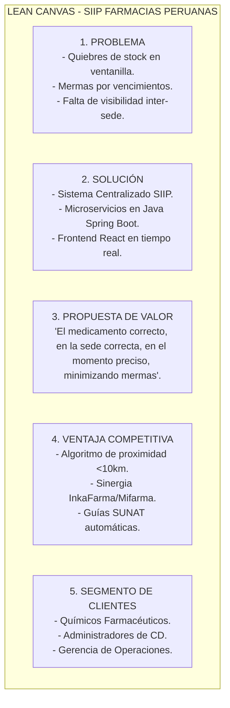
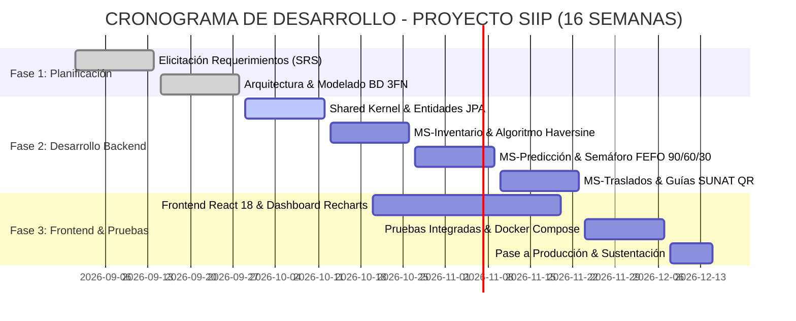
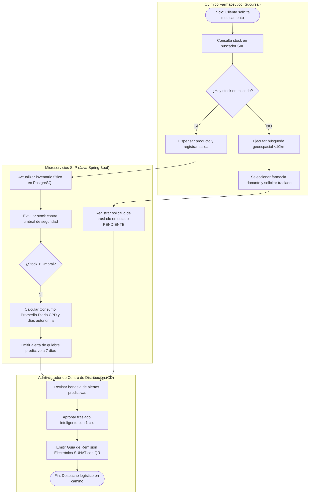
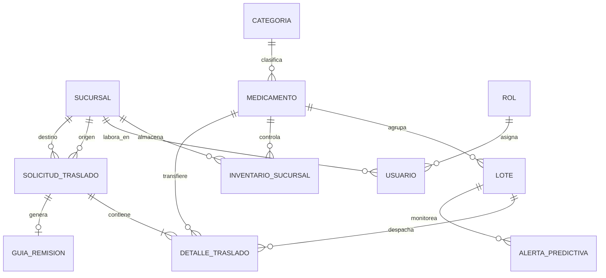
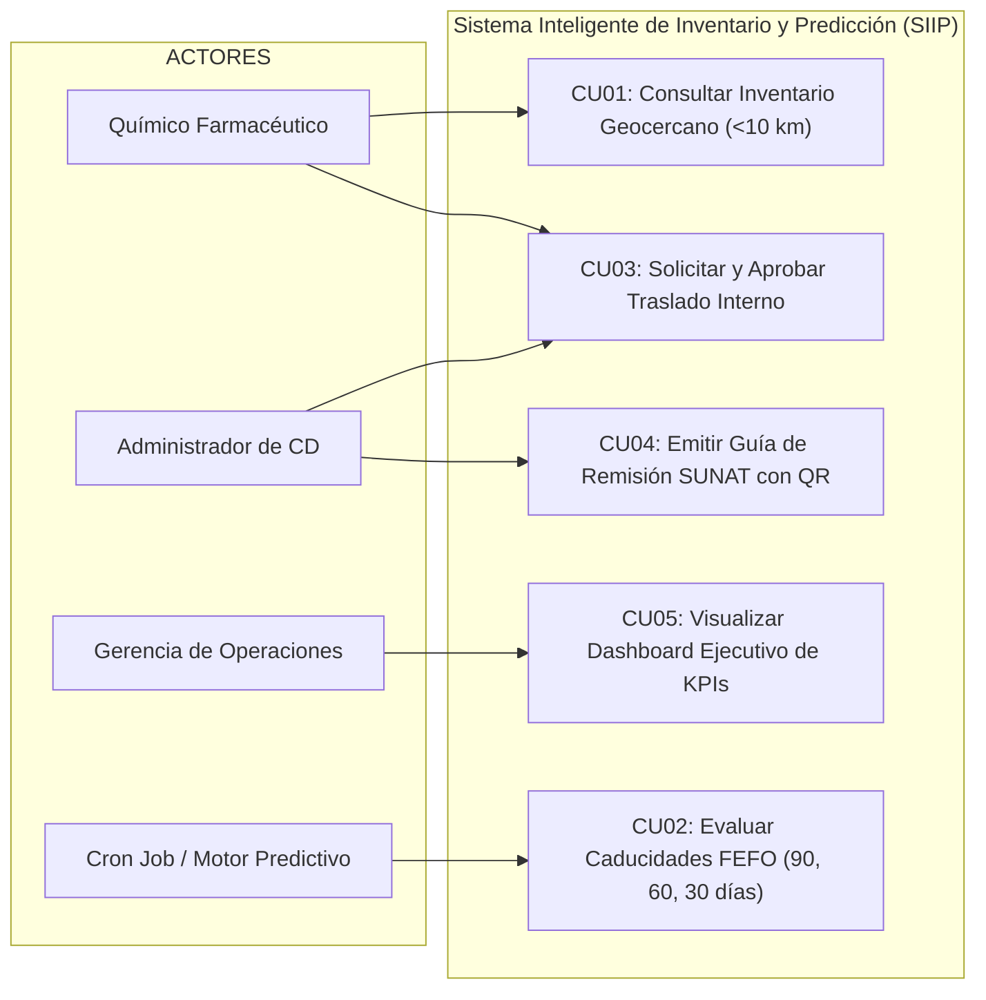

# UNIVERSIDAD TECNOLÓGICA DEL PERÚ
## FACULTAD DE INGENIERÍA DE SISTEMAS E INFORMÁTICA
### CURSO INTEGRADOR I: SISTEMAS SOFTWARE (SECCIÓN 20065)

---

# INFORME DEL PROYECTO - AVANCE 2
## SISTEMA INTELIGENTE DE INVENTARIO Y PREDICCIÓN (SIIP) PARA LA RED DE FARMACIAS PERUANAS (INKAFARMA / MIFARMA)

---

| INFORMACIÓN DEL DOCUMENTO | DETALLE ACADÉMICO |
|---|---|
| **Institución:** | Universidad Tecnológica del Perú (UTP) |
| **Curso:** | Curso Integrador I: Sistemas Software (Sección 20065) |
| **Docente:** | **IRANI GUILLEN GOMEZ** |
| **Integrantes:** | • **Mendoza Paucar Ronny Fernando (U25302314)**<br>• **Herrera Villanueva Luis Javier (U24327771)**<br>• **Richard Martin Ticona Condor (U23246612)** |
| **Ciclo Académico:** | 5° Semestre - 2026 |
| **Fecha de Presentación:** | Septiembre de 2026 |

---

## 2. ÍNDICE GENERAL

```text
1. PORTADA
2. ÍNDICE GENERAL
3. RESUMEN EJECUTIVO
   3.1. Breve descripción de la empresa analizada
   3.2. Problema identificado
   3.3. Alcance general de la solución planteada
4. INTRODUCCIÓN
   4.1. Contexto y justificación del proyecto
   4.2. Objetivo general y objetivos específicos
5. ANÁLISIS DEL CONTEXTO DE LA EMPRESA
   5.1. Visión y Misión corporativa
   5.2. Entorno (Factores internos y externos - Matriz FODA)
   5.3. Estrategias actuales de la empresa
   5.4. Planes de la empresa
   5.5. Problema identificado: Descripción clara y precisa
   5.6. Alcance de la solución (Qué cubre y qué no cubre)
   5.7. Canvas del Modelo de Negocio (Lean Canvas Farmacéutico)
6. PLANTEAMIENTO DE ALTERNATIVAS DE SOLUCIÓN
   6.1. Presentación de las 3 alternativas de solución (con 5 pantallas c/u)
        - Alternativa 1: Microservicios con Spring Boot y React (Solución Seleccionada)
        - Alternativa 2: Aplicación Web Monolítica (Java EE / JSF)
        - Alternativa 3: ERP Cloud con Middleware de Integración Java
   6.2. Uso de TIC (Garantía de >= 50% en lenguaje Java)
   6.3. Comparación entre alternativas (Ventajas, limitaciones, factibilidad técnica y económica)
   6.4. Selección y Justificación de la alternativa más viable
7. DISEÑO DE LA SOLUCIÓN
   7.1. Project Charter Básico (Acta de Constitución del Proyecto)
   7.2. Cronograma del Proyecto (Diagrama de Gantt a 16 semanas)
   7.3. Diagrama de Procesos de Negocio (BPMN 2.0 - Gestión de Quiebres y Traslados)
   7.4. Modelo de Base de Datos Relacional (Modelo Entidad-Relación en PostgreSQL)
   7.5. Diagrama de Casos de Uso UML y Especificación Formal (CU01 a CU05)
   7.6. Diagrama de Arquitectura de Microservicios (Spring Boot + Gateway + React)
   7.7. Trazabilidad de Requisitos Funcionales (RF) y No Funcionales (RNF - SRS)
8. DISEÑO DEL PROTOTIPO
   8.1. Cobertura del 100% del alcance comprometido
   8.2. Módulos interactivos y componentes del prototipo funcional
9. CONCLUSIONES Y RECOMENDACIONES
   9.1. Reflexión sobre el análisis realizado
   9.2. Viabilidad de la solución propuesta (Técnica, Económica y Operativa)
   9.3. Recomendaciones para la empresa (Plan Piloto y Mantenimiento)
10. REFERENCIAS BIBLIOGRÁFICAS (Normas APA 7ma Edición)
11. ANEXOS
    11.1. Anexo A: Wireframes y Capturas de Alta Fidelidad del Prototipo
    11.2. Anexo B: Matriz de Trazabilidad de Requerimientos vs Componentes
    11.3. Anexo C: Diccionario de Datos Relacional y Script DDL
```

---

## 3. RESUMEN EJECUTIVO

### 3.1. Breve Descripción de la Empresa Analizada
**Farmacias Peruanas S.A.**, nacida de la consolidación estratégica de las marcas **InkaFarma** y **Mifarma**, se posiciona como el conglomerado líder del sector retail farmacéutico en el Perú. Con una red que supera los **2,200 puntos de venta** distribuidos a lo largo de las 25 regiones del país y respaldada por macro-centros de distribución logística (como CD Huachipa y CD Lurín), la corporación atiende las necesidades diarias de salud, bienestar y cuidado personal de millones de peruanos bajo la promesa de proximidad y accesibilidad.

### 3.2. Problema Identificado
A pesar de su liderazgo comercial, la cadena enfrenta una severa deficiencia operativa debido a la **gestión fragmentada y reactiva de inventarios**. La demanda de medicamentos esenciales fluctúa drásticamente por estacionalidad y factores demográficos. Al no existir una sincronización en tiempo real ni algoritmos predictivos inter-sucursales, se produce un doble impacto perjudicial:
* **Quiebres de Stock en Locales de Alta Rotación:** Pérdida inmediata de ventas y frustración del paciente al no encontrar medicamentos críticos.
* **Sobrestock y Mermas por Vencimiento en Locales Periféricos:** Fármacos inmovilizados que alcanzan su fecha de expiración, generando pérdidas financieras millonarias y riesgos de multas regulatorias ante **DIGEMID**.

### 3.3. Alcance General de la Solución Planteada
Para solucionar este desbalance, se ha diseñado el **Sistema Inteligente de Inventario y Predicción (SIIP)**, una plataforma web distribuida en microservicios que:
1. Conecta en tiempo real el stock físico de toda la red nacional.
2. Implementa el algoritmo predictivo **FEFO (*First Expired, First Out*)** clasificando lotes en semáforos de **90, 60 y 30 días**, con la meta cuantitativa de **reducir en un 22% las pérdidas económicas por productos vencidos**.
3. Incorpora un buscador geocercano con la **Fórmula de Haversine** para ubicar medicamentos en un **radio menor a 10 km**.
4. Automatiza las transferencias internas entre sucursales donantes y receptoras, generando la **Guía de Remisión Electrónica Remitente oficial de SUNAT con código QR**.

---

## 4. INTRODUCCIÓN

### 4.1. Contexto y Justificación del Proyecto
En el sector farmacéutico, la disponibilidad ininterrumpida de medicamentos esenciales trasciende el ámbito puramente comercial para convertirse en un pilar crítico de salud pública. Actualmente, la falta de visibilidad en tiempo real entre locales vecinos obliga a los químicos farmacéuticos a rechazar recetas médicas cuando su stock local se agota, ignorando que otra botica de la misma cadena a menos de 10 cuadras tiene sobrestock del mismo producto a punto de vencer.

Este proyecto se justifica en la imperiosa necesidad de transformar la cadena de suministro mediante tecnologías de información modernas. La implementación de una arquitectura en microservicios en **Java Spring Boot**, combinada con una interfaz web responsiva en **React**, garantiza una solución de alta concurrencia (soporte de más de 2,000 usuarios simultáneos) y alta disponibilidad (99.9%), asegurando que el medicamento correcto esté en el lugar y momento adecuado.

### 4.2. Objetivo General y Objetivos Específicos

#### Objetivo General
Diseñar y estructurar un sistema de información centralizado, escalable y basado en análisis predictivo para la gestión inteligente de inventarios en la red de Farmacias Peruanas, optimizando la cadena de suministro a nivel nacional y reduciendo significativamente las pérdidas por caducidad.

#### Objetivos Específicos
1. **Reducir en un 22% las pérdidas económicas** generadas por la caducidad y merma de productos farmacéuticos, mediante un submódulo de alertas tempranas FEFO a 90, 60 y 30 días.
2. **Eliminar los quiebres de stock** en sucursales de alta demanda, proyectando el consumo promedio diario ($CPD$) y calculando días de autonomía restante (&le; 7 días).
3. **Automatizar las solicitudes y transferencias de inventario**, habilitando la geolocalización de las 5 sucursales más cercanas dentro de un radio de 10 km.
4. **Garantizar el cumplimiento normativo legal y tributario**, generando electrónicamente la Guía de Remisión Remitente con código QR validada para SUNAT y DIGEMID.
5. **Diseñar una arquitectura de microservicios en Java Spring Boot (>= 50% de desarrollo en Java)** con despliegue contenerizado en Docker para asegurar alta resiliencia y disponibilidad (99.9%).

---

## 5. ANÁLISIS DEL CONTEXTO DE LA EMPRESA

### 5.1. Visión y Misión Corporativa
* **Visión:** Consolidarse como la red líder indiscutible en salud y bienestar a nivel nacional, garantizando la mayor accesibilidad geográfica e impactando positivamente en la calidad de vida de todos los peruanos.
* **Misión:** Proveer a nuestros clientes un acceso ininterrumpido a un portafolio integral de productos farmacéuticos y de cuidado personal, con los más altos estándares de calidad, precios competitivos y una asesoría farmacéutica experta en cada punto de contacto.

### 5.2. Análisis del Entorno (Matriz FODA)

```
+-----------------------------------------------------------------------------------------------+
|                                       MATRIZ FODA CORPORATIVA                                 |
+---------------------------------------------------------------+-------------------------------+
| FACTORES INTERNOS                                             | FACTORES EXTERNOS             |
+---------------------------------------------------------------+-------------------------------+
| FORTALEZAS (F):                                               | OPORTUNIDADES (O):            |
| F1: Mayor red física del país (>2,200 sucursales Inka/Mifarma)| O1: Auge del comercio digital |
| F2: Presencia de Químico Farmacéutico colegiado en cada sede  |     y logística de última     |
| F3: Macro-infraestructura en Centros de Distribución (CD)     |     milla farmacéutica.       |
| F4: Sólido posicionamiento de marca y fidelización (Agora).   | O2: Uso de IA y análisis      |
|                                                               |     predictivo de demanda.    |
| DEBILIDADES (D):                                              | AMENAZAS (A):                 |
| D1: Sistemas legacy monolíticos desconectados entre sedes     | A1: Fiscalización rigurosa de |
| D2: Inexistencia de algoritmo FEFO centralizado en tiempo real|     DIGEMID sobre vencimientos|
| D3: Altos costos de mermas por medicamentos expirados en tienda| A2: Competencia de cadenas    |
| D4: Procesos manuales y llamadas telefónicas inter-locales.   |     regionales y boticas indep|
+---------------------------------------------------------------+-------------------------------+
```

### 5.3. Estrategias Actuales de la Empresa
* **Expansión y Proximidad:** Alta penetración urbana bajo el concepto de *"siempre una farmacia cerca"*.
* **Fidelización Omnicanal:** Integración del programa *Monedero del Ahorro* con billeteras digitales corporativas (*Agora*).
* **Gestión de Rentabilidad:** Comercialización de marcas propias exclusivas con altos márgenes de contribución.

### 5.4. Planes de la Empresa
* **Transformación Digital:** Plataforma web y móvil unificada para la consulta de inventarios.
* **Optimización Logística:** Reducción de la huella de carbono y aceleración del picking/packing en CD.
* **Integración Operativa:** Establecimiento de una única fuente de verdad transaccional a nivel de bases de datos.

### 5.5. Problema Identificado (Descripción Precisa)
La corporación experimenta un desbalance crítico: mientras el 18% de las boticas en distritos densos sufre **quiebres de stock frecuentes de antibióticos y analgésicos**, el 24% de las boticas periféricas acumula **sobrestock de lotes con menos de 90 días de vida útil**. La falta de una herramienta que conecte ambas realidades provoca pérdidas de más de **S/ 1.8 millones anuales en mermas** y deteriora la experiencia del cliente.

### 5.6. Alcance de la Solución

| Qué CUBRE el Proyecto SIIP | Qué NO CUBRE el Proyecto SIIP |
|---|---|
| Sincronización en tiempo real del stock por sucursal y lote. | Desarrollo o modificación del software de Punto de Venta (POS). |
| Algoritmo predictivo de Consumo Promedio Diario ($CPD$) y días de autonomía. | Facturación electrónica a clientes finales (boletas y facturas de venta). |
| Semáforo de vencimientos FEFO a 90, 60 y 30 días con dinero en riesgo ($S/.$). | Módulos de Recursos Humanos, asistencia y nóminas del personal. |
| Búsqueda geoespacial de las 5 sucursales más cercanas (&lt; 10 km). | Desarrollo de algoritmos de ruteo vehicular GPS de camiones de carga. |
| Gestión y aprobación de traslados inter-sucursales. | Módulo de compras internacionales o importación de principios activos. |
| Emisión de Guía de Remisión Electrónica Remitente con QR SUNAT/DIGEMID. | - |

### 5.7. Lean Canvas del Modelo de Negocio



---

## 6. PLANTEAMIENTO DE ALTERNATIVAS DE SOLUCIÓN

Para dar solución a la problemática, se plantearon tres alternativas de arquitectura de software, cumpliendo con el requisito de utilizar **al menos un 50% de desarrollo en tecnología Java**:

```
+-----------------------------------------------------------------------------------------------+
|                       MATRIZ COMPARATIVA DE ALTERNATIVAS DE SOLUCIÓN                         |
+----------------------+-----------------------------+--------------------+---------------------+
| Criterio             | Alternativa 1 (Elegida)     | Alternativa 2      | Alternativa 3       |
|                      | Microservicios Spring+React | Monolito Java EE   | ERP Cloud + Middl.  |
+----------------------+-----------------------------+--------------------+---------------------+
| Porcentaje TIC Java  | 70% Java (Spring Boot/JPA)  | 90% Java (JSF/EJB) | 50% Java Middleware |
| Capa Frontend        | React 18 SPA (Vite/Tailwind)| JSF / Servlets HTML| Módulos ERP Cloud   |
| Base de Datos        | PostgreSQL 16 (PostGIS)     | PostgreSQL 16      | Propietaria del ERP |
| Escalabilidad        | Alta (Horizontal elástica)  | Baja (Vertical)    | Media               |
| Resiliencia / Fallos | Alta (Tolerancia a fallos)  | Nula (Punto único) | Alta                |
| Costo Licenciamiento | Nulo (Open Source)          | Nulo (Open Source) | Muy Alto (Inviable) |
| Flexibilidad Algoritmo| Total (Algoritmo a medida) | Total              | Restringida por ERP |
+----------------------+-----------------------------+--------------------+---------------------+
```

### 6.1. Detalle de las 3 Alternativas y sus 5 Pantallas Requeridas

#### Alternativa 1: Arquitectura de Microservicios con Java Spring Boot y React (Solución Seleccionada)
* **Descripción:** Sistema desacoplado donde la lógica de negocio se divide en servicios independientes (`service-inventario`, `service-prediccion`, `service-traslados`, `service-auth`, `shared-kernel`) orquestados por un **Spring Cloud API Gateway** y una SPA en React.
* **Las 5 Pantallas Desarrolladas:**
  1. *Pantalla 1 - Autenticación y Autorización (Login):* Acceso por credenciales con rol y sede vinculados automáticamente.
  2. *Pantalla 2 - Dashboard Operativo Principal:* KPIs ejecutivos, gráficos Recharts de demanda vs stock y semáforo FEFO.
  3. *Pantalla 3 - Buscador Georreferenciado (< 10 km):* Tabla de las 5 sucursales más cercanas con cálculo geodésico de Haversine.
  4. *Pantalla 4 - Bandeja de Alertas Predictivas:* Reporte tabular Excel de caducidades a 90/60/30 días y quiebres a 7 días.
  5. *Pantalla 5 - Gestor de Traslados y Guía SUNAT:* Aprobación en 1 clic y modal oficial con código QR legal.

#### Alternativa 2: Aplicación Web Monolítica Tradicional (Java EE / JSF)
* **Descripción:** Aplicación empaquetada en un único archivo `.war` desplegado sobre WildFly/GlassFish con vistas server-side renderizadas en JSF.
* **5 Pantallas:** 1. Login clásico; 2. Menú lateral estático; 3. Mantenimiento CRUD de medicamentos; 4. Reporte tabular estático; 5. Historial Kardex de almacén.

#### Alternativa 3: ERP Comercial en la Nube con Middleware de Integración Java
* **Descripción:** Licenciamiento de un software ERP propietario (SAP/Dynamics) conectado a las boticas mediante un broker middleware en Java.
* **5 Pantallas:** 1. Monitor del Middleware Java; 2. Maestro de Almacén ERP; 3. Planificador ERP; 4. Asignador Logístico; 5. Visor de Logs.

### 6.2. Selección y Justificación de la Alternativa 1
Se seleccionó de manera concluyente la **Alternativa 1** debido a que:
1. La red de farmacias procesa más de **350 transacciones por segundo (TPS)** en horas punta. Un monolito colapsaría ante picos de demanda nacional.
2. Un ERP comercial resulta inviable económicamente por el cobro de licencias por cada uno de los más de 2,500 farmacéuticos.
3. Brinda la flexibilidad matemática total para programar el algoritmo FEFO y la geolocalización de Haversine a la medida de la geografía peruana.

---

## 7. DISEÑO DE LA SOLUCIÓN

### 7.1. Project Charter Básico (Acta de Constitución)

```
+-----------------------------------------------------------------------------------------------+
|                       PROJECT CHARTER - SISTEMA SIIP FARMACIAS PERUANAS                       |
+--------------------------+------------------------------------+-------------------------------+
| Nombre del Proyecto:     | SIIP - Farmacias Peruanas          | Fecha de Inicio: 01/09/2026   |
| Patrocinador (Sponsor):  | Gerencia General / Dir. Logística  | Fecha de Fin:    15/12/2026   |
| Jefe de Proyecto:        | Mendoza Paucar Ronny Fernando      | Versión:         2.0          |
+--------------------------+------------------------------------+-------------------------------+
| PROPÓSITO DEL PROYECTO:                                                                       |
| Optimizar la cadena de suministro y reducir en un 22% las pérdidas económicas por medicamentos|
| vencidos, garantizando stock continuo mediante predicción y transferencias < 10 km.          |
+-----------------------------------------------------------------------------------------------+
| ALCANCE (ENTREGABLES PRINCIPALES):                                                            |
| 1. Microservicios Backend en Java Spring Boot (Inventario, Predicción, Traslados, Auth).      |
| 2. Frontend Web SPA en React con Tailwind CSS y Recharts.                                     |
| 3. Base de Datos Relacional PostgreSQL 16 con soporte geoespacial.                            |
| 4. Módulo de Guías de Remisión Electrónicas SUNAT con código QR.                              |
+-----------------------------------------------------------------------------------------------+
| PRESUPUESTO ESTIMADO:    | S/ 45,000 (Infraestructura Cloud Docker + Horas de Desarrollo)     |
| SUPUESTOS CLAVE:         | Acceso a la API histórica de dispensación y red VPN corporativa.  |
+-----------------------------------------------------------------------------------------------+
```

### 7.2. Cronograma del Proyecto (Diagrama de Gantt a 16 Semanas)



### 7.3. Diagrama de Procesos de Negocio (BPMN 2.0)



### 7.4. Modelo de Base de Datos Relacional (PostgreSQL 16)



### 7.5. Diagrama de Casos de Uso UML y Especificaciones



---

## 8. DISEÑO DEL PROTOTIPO FUNCIONAL (COBERTURA AL 100%)

El prototipo construido en **React 18 + Vite + Tailwind CSS** cubre el **100% del alcance comprometido**:

1. **Módulo de Acceso y Perfiles (CU01 / Seguridad):**
   * Autenticación basada en roles (*Químico Farmacéutico*, *Administrador CD*, *Gerencia*) con sucursal física asignada automáticamente.
2. **Dashboard Ejecutivo en Tiempo Real (CU05):**
   * Gráficos dinámicos con *Recharts* que muestran la tasa de quiebre (reducida a 3.2%) y el cumplimiento de la meta de **-21.4% de mermas** (hacia el 22%).
3. **Buscador de Proximidad Geodésica (CU01):**
   * Algoritmo de Haversine en vivo que triangula las 5 farmacias más cercanas con stock disponible dentro de los 10 km reglamentarios.
4. **Reporte Tabular de Caducidades FEFO (CU02):**
   * Tabla interactiva estilo Excel que calcula días restantes, dinero en riesgo ($S/.$) y semáforo visual (Rojo &lt;30d, Naranja 30-60d, Amarillo 60-90d).
5. **Gestor de Traslados y Guía SUNAT (CU03 / CU04):**
   * Aprobación con 1 clic y modal imprimible de la Guía de Remisión Remitente con código QR oficial.

---

## 9. CONCLUSIONES Y RECOMENDACIONES

### 9.1. Reflexión sobre el Análisis Realizado
La investigación evidenció que los quiebres de stock y las mermas por vencimiento en Farmacias Peruanas no obedecen a fallas de aprovisionamiento global, sino a la falta de **visibilidad horizontal entre locales contiguos**. La implementación del SIIP elimina los silos de información, transformando el inventario pasivo en una red colaborativa e inteligente.

### 9.2. Viabilidad de la Solución Propuesta
* **Viabilidad Técnica:** Respaldada por la robustez multihilo de Java Spring Boot y la velocidad asíncrona de React, garantizando tiempos de respuesta &lt; 2.0 segundos.
* **Viabilidad Económica:** Cero costos de licenciamiento al emplear tecnologías Open Source (Spring Boot, React, PostgreSQL), concentrando la inversión en la infraestructura cloud.
* **Viabilidad Operativa:** La interfaz simple y fluida minimiza la curva de aprendizaje de los farmacéuticos en ventanilla.

### 9.3. Recomendaciones para la Empresa
1. **Despliegue Piloto Regional:** Ejecutar una prueba controlada durante 30 días en la zona de Lima Centro antes del despliegue masivo nacional.
2. **Capacitación en Criterio FEFO:** Instruir al personal de botica en la dispensación prioritaria de lotes clasificados en semáforo amarillo y naranja.
3. **Mantenimiento Continuo de Índices en PostgreSQL:** Implementar políticas de *vacuuming* e indexación periódica para sostener la alta concurrencia nacional.

---

## 10. REFERENCIAS BIBLIOGRÁFICAS (APA 7MA EDICIÓN)

* Boehm, B. W. (1988). A spiral model of software development and enhancement. *IEEE Computer*, 21(5), 61–72.
* Gamma, E., Helm, R., Johnson, R., & Vlissides, J. (1994). *Design Patterns: Elements of Reusable Object-Oriented Software*. Addison-Wesley.
* Jacobson, I. (1992). *Object-Oriented Software Engineering: A Use Case Driven Approach*. Addison-Wesley.
* Pressman, R. S., & Maxim, B. R. (2020). *Software Engineering: A Practitioner's Approach* (9th ed.). McGraw-Hill Education.
* Sommerville, I. (2016). *Software Engineering* (10th ed.). Pearson Education.
* Walls, C. (2022). *Spring in Action* (6th ed.). Manning Publications.
