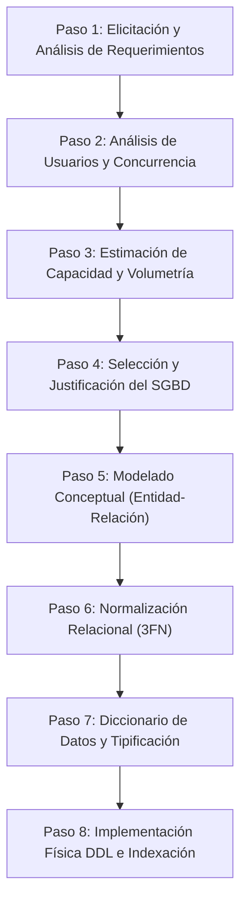
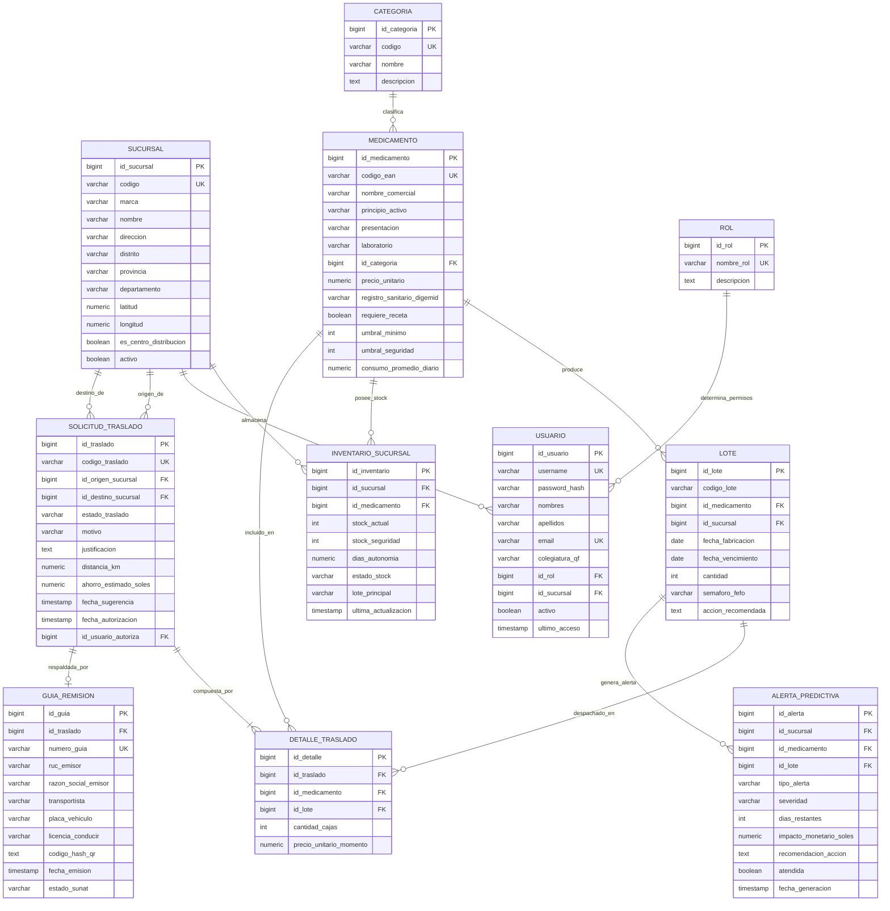

# UNIVERSIDAD TECNOLÓGICA DEL PERÚ
## FACULTAD DE INGENIERÍA DE SISTEMAS E INFORMÁTICA
### CURSO INTEGRADOR I: SISTEMAS SOFTWARE (SECCIÓN 20065)

---

# S06 - TRABAJO DE BASE DE DATOS
## DISEÑO Y ESTRUCTURACIÓN DE LA BASE DE DATOS RELACIONAL: SISTEMA INTELIGENTE DE INVENTARIO Y PREDICCIÓN (SIIP) - FARMACIAS PERUANAS (INKAFARMA / MIFARMA)

---

| INFORMACIÓN ACADÉMICA | DETALLE |
|---|---|
| **Institución:** | Universidad Tecnológica del Perú (UTP) |
| **Curso:** | Curso Integrador I: Sistemas Software (Sección 20065) |
| **Docente:** | IRANI GUILLEN GOMEZ |
| **Estudiante:** | **Mendoza Paucar Ronny Fernando** |
| **Código UTP:** | **U25302314** |
| **Fecha de Entrega:** | 18 de septiembre de 2026 |
| **Ciclo Académico:** | 5° Semestre - 2026 |

---

## 1. INTRODUCCIÓN Y CONTEXTO DEL ESCENARIO SIMULADO

### 1.1. Contexto Empresarial
El presente diseño de base de datos se fundamenta en el proyecto de software corporativo para **Farmacias Peruanas S.A.** (cadena líder en retail farmacéutico que consolida las marcas comerciales **InkaFarma** y **Mifarma**). La corporación opera una extensa red de más de 2,200 locales distribuidos a nivel nacional, respaldados por Centros de Distribución (CD) de alta capacidad (ej. CD Huachipa y CD Lurín).

### 1.2. Problemática y Propósito de la Base de Datos
La empresa enfrenta dos problemas logísticos centrales:
1. **Quiebres de Stock:** Falta de productos en sedes de alta rotación por variabilidad en la demanda y falta de visibilidad en tiempo real.
2. **Mermas por Vencimiento:** Pérdidas financieras elevadas generadas por medicamentos caducados en sucursales de baja rotación.

La base de datos del **Sistema Inteligente de Inventario y Predicción (SIIP)** tiene como objetivo ser la *única fuente de verdad* (Single Source of Truth) para:
* Sincronizar el inventario físico en tiempo real tras cada dispensación en ventanilla.
* Implementar el algoritmo **FEFO (*First Expired, First Out*)** categorizando lotes en un semáforo de 90, 60 y 30 días para cumplir con la meta de **reducir en un 22% las pérdidas económicas por vencidos**.
* Georreferenciar las farmacias para permitir consultas de stock en un **radio menor a 10 kilómetros** mediante la fórmula de Haversine.
* Respaldar transaccionalmente las órdenes de traslado y la emisión de **Guías de Remisión Electrónicas Remitente con código QR** conforme a las normativas de **SUNAT** y **DIGEMID**.

---

## 2. PROCEDIMIENTOS A SEGUIR PARA LA ESTRUCTURACIÓN DE LA BASE DE DATOS DE INICIO A FIN

A continuación, se detalla el ciclo metodológico formal seguido para la concepción, dimensionamiento y diseño de la base de datos relacional:



---

### 2.1. Análisis de Usuarios, Perfiles y Carga Concurrente

Para dimensionar adecuadamente el motor de base de datos y su pool de conexiones, se analizan los roles operativos que interactúan con el sistema:

| Perfil / Rol | Cantidad de Usuarios | Tipo de Operación en BD | Frecuencia de Acceso | Concurrencia Máxima Estimada |
|---|:---:|---|---|:---:|
| **Químico Farmacéutico (Ventanilla)** | ~2,500 usuarios | `SELECT` (Stock local y sedes <10km), `UPDATE` (Resta de stock por venta), `INSERT` (Solicitud manual traslado). | Continua (Turnos rotativos 07:00 a 23:00). | **1,800 usuarios concurrentes** |
| **Administrador de Centro de Distribución (CD)** | ~80 usuarios | `SELECT` (Alertas predictivas a 7 días y vencimientos FEFO), `UPDATE` (Aprobación de traslados), `INSERT` (Generación de Guías de Remisión). | Frecuente (Horario logístico). | **50 usuarios concurrentes** |
| **Gerencia de Operaciones y Mermas** | ~30 usuarios | `SELECT` analítico intensivo (Reportes de mermas, KPI de reducción del 22%, tendencias de consumo). | Periódica (Reportes diarios/semanales). | **15 usuarios concurrentes** |
| **Motor Predictivo / Cron Jobs SIIP** | Proceso Daemon Backend | `SELECT` masivo (Historial de ventas últimos 14 días), `INSERT` (Bitácora de alertas predictivas), `UPDATE` (Cálculo de CPD y días de autonomía). | Cada 6 horas / Tiempo real. | **Transacciones por Lote (Batch)** |

**Total de Carga Estimada:** Procesamiento pico de **350 a 500 transacciones por segundo (TPS)** a nivel nacional, con un tiempo de respuesta exigido menor a **2.0 segundos** (cumpliendo el requisito **RNF-01**).

---

### 2.2. Estimación de Dimensionamiento y Espacio de Almacenamiento (Volumetría)

Se realiza el cálculo analítico del espacio en disco requerido para la base de datos durante el **primer año de operación**, considerando el tamaño promedio por fila de cada entidad principal:

#### Tabla de Cálculo de Bytes por Registro

| Entidad / Tabla | Bytes Promedio por Fila ($B$) | Registros Iniciales | Registros Nuevos por Mes | Tamaño Inicial | Crecimiento Anual Estimado |
|---|:---:|:---:|:---:|:---:|:---:|
| `SUCURSAL` | 420 bytes | 2,200 | 10 | 0.92 MB | 0.05 MB |
| `CATEGORIA` | 180 bytes | 50 | 2 | 0.01 MB | <0.01 MB |
| `MEDICAMENTO` | 550 bytes | 8,500 | 50 | 4.67 MB | 0.33 MB |
| `LOTE` | 260 bytes | 45,000 | 12,000 | 11.70 MB | 37.44 MB |
| `INVENTARIO_SUCURSAL` | 180 bytes | 1,870,000 | 10,000 | 336.60 MB | 21.60 MB |
| `SOLICITUD_TRASLADO` | 320 bytes | 1,000 | 15,000 | 0.32 MB | 57.60 MB |
| `DETALLE_TRASLADO` | 120 bytes | 2,500 | 35,000 | 0.30 MB | 50.40 MB |
| `GUIA_REMISION` | 680 bytes | 800 | 12,000 | 0.54 MB | 97.92 MB |
| `ALERTA_PREDICTIVA` | 290 bytes | 5,000 | 60,000 | 1.45 MB | 208.80 MB |
| `HISTORIAL_VENTAS_DIARIAS` | 150 bytes | 500,000 | 1,800,000 | 75.00 MB | 3,240.00 MB (3.24 GB) |
| `USUARIO` & `ROL` | 280 bytes | 2,650 | 20 | 0.74 MB | 0.07 MB |
| **Subtotal Datos Netos (Año 1):** | - | - | - | **432.25 MB** | **3.71 GB** |

#### Cálculo de Espacio Total con Factores Operativos
Para garantizar la estabilidad del servidor en producción, se aplican factores estándar de la industria:
1. **Espacio para Índices B-Tree y Geoespaciales (40% de los datos):** $3.71 \text{ GB} \times 0.40 = 1.48 \text{ GB}$.
2. **Logs Transaccionales / WAL (Write-Ahead Logging) y Auditoría (30%):** $3.71 \text{ GB} \times 0.30 = 1.11 \text{ GB}$.
3. **Margen de Seguridad y Crecimiento Imprevisto (50%):** $3.71 \text{ GB} \times 0.50 = 1.85 \text{ GB}$.

$$\text{Espacio Total Proyectado (Año 1)} = 3.71 \text{ GB} + 1.48 \text{ GB} + 1.11 \text{ GB} + 1.85 \text{ GB} \approx \mathbf{8.15 \text{ GB}}$$
$$\text{Proyección a 5 Años con Políticas de Purga/Particionamiento} \approx \mathbf{42.5 \text{ GB}}$$

**Determinación de Infraestructura:** Se requiere asignar un volumen SSD con aprovisionamiento inicial de **100 GB** (escalable a 500 GB) con IOPS dedicados para asegurar tiempos de lectura inferiores a 10 ms.

---

### 2.3. Selección y Justificación del Sistema Gestor de Base de Datos (SGBD)

Se evaluaron las principales alternativas de SGBD del mercado para soportar la arquitectura de microservicios:

```
+-------------------------------------------------------------------------------+
|                      MATRIZ COMPARATIVA DE SGBD CANDIDATOS                    |
+---------------------+-------------------+-----------------+-------------------+
| Criterio Evaluado   | PostgreSQL 16     | MySQL 8.0       | Oracle Database   |
+---------------------+-------------------+-----------------+-------------------+
| Transaccionalidad   | ACID Completo     | ACID (InnoDB)   | ACID Completo     |
| Extensiones Geo     | PostGIS (Nativo)  | Básico GIS      | Oracle Spatial    |
| Particionamiento    | Nativo Declarat.  | Nativo          | Muy Avanzado      |
| Concurrencia (MVCC) | Excelente (MVCC)  | Bueno           | Excelente         |
| Costo Licenciamiento| Open Source ($0)  | Open Source ($0)| Licencia Enterprise|
| Integración Spring  | Spring Data JPA   | Spring Data JPA | Spring Data JPA   |
+---------------------+-------------------+-----------------+-------------------+
```

#### Justificación Técnica de la Elección: **PostgreSQL 16 Enterprise**
1. **Cumplimiento de Propiedades ACID:** Garantiza que las reservas de stock en transferencias entre sucursales se ejecuten como operaciones atómicas, impidiendo ventas duplicadas de la misma caja de medicamentos.
2. **Capacidad Geoespacial Nativa (PostGIS):** Permite ejecutar la fórmula de Haversine y calcular cuadrantes de proximidad geodésica (<10 km) directamente en motor de base de datos con índices `GIST` espaciales.
3. **Soporte Nativo de JSONB:** Facilita almacenar parámetros predictivos dinámicos y detalles de guías SUNAT sin desnormalizar tablas principales.
4. **Costo Total de Propiedad (TCO):** Al ser código abierto, ahorra cientos de miles de dólares en licencias por núcleo que cobraría un motor propietario como Oracle, maximizando la viabilidad económica del proyecto.

---

## 3. DISEÑO DE LA BASE DE DATOS RELACIONAL (A NIVEL ESQUEMÁTICO)

### 3.1. Diagrama Entidad-Relación Completo (Modelo E-R)

El siguiente diagrama modela la totalidad de las relaciones, cardinalidades y claves del sistema SIIP:



---

### 3.2. Normalización del Esquema Relacional (Tercera Forma Normal - 3FN)

El diseño cumple estrictamente con las reglas de normalización:

1. **Primera Forma Normal (1FN):**
   * Todos los atributos contienen valores atómicos e indivisibles (ej. se separan `nombres`, `apellidos`, `distrito`, `provincia`).
   * No existen grupos repetitivos de medicamentos dentro de la orden de traslado; se crea la tabla puente `DETALLE_TRASLADO`.

2. **Segunda Forma Normal (2FN):**
   * El modelo está en 1FN y cada atributo que no es clave depende total y exclusivamente de la clave primaria (PK). En `DETALLE_TRASLADO`, los atributos dependen de `id_detalle` y no de combinaciones parciales.

3. **Tercera Forma Normal (3FN):**
   * No existen dependencias transitivas. Por ejemplo, en la tabla `MEDICAMENTO` no se almacena el nombre y descripción de la categoría, sino la llave foránea `id_categoria`, evitando anomalías de actualización y redundancia.

---

## 4. DICCIONARIO DE DATOS CONCEPTUAL Y CATEGORIZACIÓN EN FORMATO TABLA

A continuación, se documenta la especificación técnica y propiedades de cada una de las tablas del sistema:

---

### Tabla 1: `SUCURSAL` (Locales Físicos y Centros de Distribución)
- **Descripción:** Almacena el maestro de sucursales de InkaFarma, Mifarma y Centros de Distribución con sus coordenadas geodésicas.

| Nombre del Campo | Tipo de Dato | Longitud | Permite Nulos | Clave | Restricciones / Reglas | Descripción Conceptual |
|---|---|:---:|:---:|:---:|---|---|
| `id_sucursal` | `BIGINT` | - | **NO** | **PK** | `PRIMARY KEY AUTO_INCREMENT` | Identificador único de la sucursal. |
| `codigo` | `VARCHAR` | 20 | **NO** | **UK** | `UNIQUE` (Ej: 'SUC-001') | Código corporativo de la sede. |
| `marca` | `VARCHAR` | 50 | **NO** | - | `CHECK (marca IN ('InkaFarma', 'Mifarma', 'Corporativo'))` | Marca comercial del local. |
| `nombre` | `VARCHAR` | 150 | **NO** | - | - | Nombre descriptivo de la sucursal. |
| `direccion` | `VARCHAR` | 250 | **NO** | - | - | Dirección física y nomenclatura vial. |
| `distrito` | `VARCHAR` | 100 | **NO** | - | - | Distrito de ubicación territorial. |
| `provincia` | `VARCHAR` | 100 | **NO** | - | Valor por defecto: 'Lima' | Provincia política. |
| `departamento` | `VARCHAR` | 100 | **NO** | - | Valor por defecto: 'Lima' | Departamento geográfico. |
| `telefono` | `VARCHAR` | 50 | SÍ | - | - | Teléfono de contacto y anexos. |
| `latitud` | `NUMERIC` | 10, 7 | **NO** | - | `latitud BETWEEN -90 AND 90` | Coordenada GPS latitud para Haversine. |
| `longitud` | `NUMERIC` | 10, 7 | **NO** | - | `longitud BETWEEN -180 AND 180` | Coordenada GPS longitud para Haversine. |
| `es_centro_distribucion`| `BOOLEAN` | - | **NO** | - | `DEFAULT FALSE` | Indicador si la sede es un CD Central. |
| `activo` | `BOOLEAN` | - | **NO** | - | `DEFAULT TRUE` | Estado lógico del establecimiento. |

---

### Tabla 2: `CATEGORIA` (Familias Terapéuticas)
- **Descripción:** Clasificación farmacológica y terapéutica de los medicamentos.

| Nombre del Campo | Tipo de Dato | Longitud | Permite Nulos | Clave | Restricciones / Reglas | Descripción Conceptual |
|---|---|:---:|:---:|:---:|---|---|
| `id_categoria` | `BIGINT` | - | **NO** | **PK** | `PRIMARY KEY AUTO_INCREMENT` | Identificador único de la categoría. |
| `codigo` | `VARCHAR` | 20 | **NO** | **UK** | `UNIQUE` (Ej: 'CAT-ANTIB') | Código mnemotécnico. |
| `nombre` | `VARCHAR` | 100 | **NO** | - | Ej: 'Antibióticos', 'Analgésicos' | Nombre de la familia farmacológica. |
| `descripcion` | `TEXT` | - | SÍ | - | - | Detalle y alcance de la categoría. |

---

### Tabla 3: `MEDICAMENTO` (Catálogo Maestro de Fármacos)
- **Descripción:** Maestro de fármacos regulados por DIGEMID con umbrales de seguridad y consumo promedio diario ($CPD$).

| Nombre del Campo | Tipo de Dato | Longitud | Permite Nulos | Clave | Restricciones / Reglas | Descripción Conceptual |
|---|---|:---:|:---:|:---:|---|---|
| `id_medicamento` | `BIGINT` | - | **NO** | **PK** | `PRIMARY KEY AUTO_INCREMENT` | Identificador único del fármaco. |
| `codigo_ean` | `VARCHAR` | 30 | **NO** | **UK** | `UNIQUE` (Código de barras) | Código estándar EAN-13 / GTIN. |
| `nombre_comercial` | `VARCHAR` | 150 | **NO** | - | - | Nombre comercial de venta al público. |
| `principio_activo` | `VARCHAR` | 150 | **NO** | - | - | DCI (Denominación Común Internacional). |
| `presentacion` | `VARCHAR` | 100 | **NO** | - | Ej: 'Caja x 100 Cápsulas' | Formato y forma farmacéutica. |
| `laboratorio` | `VARCHAR` | 100 | **NO** | - | Ej: 'Medifarma S.A.' | Laboratorio fabricante o importador. |
| `id_categoria` | `BIGINT` | - | **NO** | **FK** | `REFERENCES CATEGORIA(id_categoria)` | Llave foránea a la categoría. |
| `precio_unitario` | `NUMERIC` | 10, 2 | **NO** | - | `CHECK (precio_unitario > 0)` | Precio de venta en moneda nacional (S/.). |
| `registro_sanitario_digemid` | `VARCHAR` | 50 | **NO** | - | Ej: 'EN-04892 DIGEMID' | Registro legal sanitario oficial. |
| `requiere_receta` | `BOOLEAN` | - | **NO** | - | `DEFAULT FALSE` | Indicador si es de venta bajo receta (Rx). |
| `umbral_minimo` | `INT` | - | **NO** | - | `CHECK (umbral_minimo >= 0)` | Stock mínimo de alerta preventiva. |
| `umbral_seguridad` | `INT` | - | **NO** | - | `CHECK (umbral_seguridad >= umbral_minimo)` | Stock de seguridad requerido. |
| `consumo_promedio_diario` | `NUMERIC` | 8, 2 | **NO** | - | `DEFAULT 0.00` | Ritmo promedio de venta diaria ($CPD$). |

---

### Tabla 4: `LOTE` (Trazabilidad FEFO y Vencimientos)
- **Descripción:** Registro específico de cada lote producido y ubicado en sucursal para aplicar el algoritmo FEFO.

| Nombre del Campo | Tipo de Dato | Longitud | Permite Nulos | Clave | Restricciones / Reglas | Descripción Conceptual |
|---|---|:---:|:---:|:---:|---|---|
| `id_lote` | `BIGINT` | - | **NO** | **PK** | `PRIMARY KEY AUTO_INCREMENT` | Identificador único del lote. |
| `codigo_lote` | `VARCHAR` | 50 | **NO** | - | Ej: 'LT-AMX-2024-V1' | Código alfanumérico impreso en caja. |
| `id_medicamento` | `BIGINT` | - | **NO** | **FK** | `REFERENCES MEDICAMENTO(id_medicamento)` | Fármaco al que pertenece el lote. |
| `id_sucursal` | `BIGINT` | - | **NO** | **FK** | `REFERENCES SUCURSAL(id_sucursal)` | Sucursal donde está ubicado el lote. |
| `fecha_fabricacion` | `DATE` | - | **NO** | - | - | Fecha de manufactura en laboratorio. |
| `fecha_vencimiento` | `DATE` | - | **NO** | - | `CHECK (fecha_vencimiento > fecha_fabricacion)` | Fecha límite de caducidad. |
| `cantidad` | `INT` | - | **NO** | - | `CHECK (cantidad >= 0)` | Cajas físicas disponibles del lote. |
| `semaforo_fefo` | `VARCHAR` | 20 | **NO** | - | `CHECK (semaforo_fefo IN ('ROJO', 'NARANJA', 'AMARILLO', 'VERDE'))` | Clasificación FEFO (90, 60, 30 días). |
| `accion_recomendada` | `TEXT` | - | SÍ | - | - | Acción automática sugerida por SIIP. |

---

### Tabla 5: `INVENTARIO_SUCURSAL` (Estado y Autonomía en Tiempo Real)
- **Descripción:** Matriz consolidada del stock por medicamento en cada sede física de la red.

| Nombre del Campo | Tipo de Dato | Longitud | Permite Nulos | Clave | Restricciones / Reglas | Descripción Conceptual |
|---|---|:---:|:---:|:---:|---|---|
| `id_inventario` | `BIGINT` | - | **NO** | **PK** | `PRIMARY KEY AUTO_INCREMENT` | Identificador único del registro de inventario. |
| `id_sucursal` | `BIGINT` | - | **NO** | **FK** | `REFERENCES SUCURSAL(id_sucursal)` | Sucursal evaluada. |
| `id_medicamento` | `BIGINT` | - | **NO** | **FK** | `REFERENCES MEDICAMENTO(id_medicamento)` | Medicamento evaluado. |
| `stock_actual` | `INT` | - | **NO** | - | `CHECK (stock_actual >= 0)` | Cantidad física disponible en local. |
| `stock_seguridad` | `INT` | - | **NO** | - | - | Nivel de seguridad asignado a la sede. |
| `dias_autonomia` | `NUMERIC` | 6, 1 | **NO** | - | $\text{dias} = \text{stock\_actual} / \text{CPD}$ | Días proyectados antes del quiebre. |
| `estado_stock` | `VARCHAR` | 30 | **NO** | - | `CHECK (estado_stock IN ('OPTIMO', 'SOBRESTOCK', 'QUIEBRE_CRITICO', 'ALERTA_BAJA'))` | Diagnóstico automático del inventario. |
| `lote_principal` | `VARCHAR` | 50 | SÍ | - | - | Lote activo más próximo a vencer (FEFO). |
| `ultima_actualizacion`| `TIMESTAMP`| - | **NO** | - | `DEFAULT CURRENT_TIMESTAMP` | Fecha y hora exacta de sincronización. |

---

### Tabla 6: `SOLICITUD_TRASLADO` (Cabecera de Órdenes de Movimiento)
- **Descripción:** Solicitudes y órdenes de transferencia inteligente entre sucursales para balanceo de sobrestock a quiebres.

| Nombre del Campo | Tipo de Dato | Longitud | Permite Nulos | Clave | Restricciones / Reglas | Descripción Conceptual |
|---|---|:---:|:---:|:---:|---|---|
| `id_traslado` | `BIGINT` | - | **NO** | **PK** | `PRIMARY KEY AUTO_INCREMENT` | Identificador único del traslado. |
| `codigo_traslado` | `VARCHAR` | 30 | **NO** | **UK** | `UNIQUE` (Ej: 'TRA-2026-00891') | Código correlativo del traslado. |
| `id_origen_sucursal`| `BIGINT` | - | **NO** | **FK** | `REFERENCES SUCURSAL(id_sucursal)` | Sede donante con sobrestock. |
| `id_destino_sucursal`| `BIGINT` | - | **NO** | **FK** | `REFERENCES SUCURSAL(id_sucursal)` | Sede receptora con quiebre. |
| `estado_traslado` | `VARCHAR` | 30 | **NO** | - | `CHECK (estado_traslado IN ('PROPUESTO', 'PENDIENTE', 'APROBADO_EN_TRANSITO', 'ENTREGADO', 'RECHAZADO'))` | Estado del ciclo de vida del traslado. |
| `motivo` | `VARCHAR` | 100 | **NO** | - | Ej: 'PREDICCION_QUIEBRE_7_DIAS' | Justificación del algoritmo SIIP. |
| `justificacion` | `TEXT` | - | SÍ | - | - | Detalle técnico del requerimiento. |
| `distancia_km` | `NUMERIC` | 6, 2 | **NO** | - | `CHECK (distancia_km <= 10.0)` | Distancia calculada por Haversine (<10km). |
| `ahorro_estimado_soles`| `NUMERIC` | 10, 2 | SÍ | - | - | Valor económico rescatado de merma. |
| `fecha_sugerencia` | `TIMESTAMP` | - | **NO** | - | `DEFAULT CURRENT_TIMESTAMP` | Momento de generación por el sistema. |
| `fecha_autorizacion`| `TIMESTAMP` | - | SÍ | - | - | Momento de aprobación por el Administrador. |
| `id_usuario_autoriza`| `BIGINT` | - | SÍ | **FK** | `REFERENCES USUARIO(id_usuario)` | Usuario que aprobó el movimiento. |

---

### Tabla 7: `DETALLE_TRASLADO` (Ítems y Lotes Transferidos)
- **Descripción:** Detalle de fármacos y lotes contenidos en una solicitud de traslado.

| Nombre del Campo | Tipo de Dato | Longitud | Permite Nulos | Clave | Restricciones / Reglas | Descripción Conceptual |
|---|---|:---:|:---:|:---:|---|---|
| `id_detalle` | `BIGINT` | - | **NO** | **PK** | `PRIMARY KEY AUTO_INCREMENT` | Identificador único del detalle. |
| `id_traslado` | `BIGINT` | - | **NO** | **FK** | `REFERENCES SOLICITUD_TRASLADO(id_traslado) ON DELETE CASCADE` | Llave foránea al traslado padre. |
| `id_medicamento` | `BIGINT` | - | **NO** | **FK** | `REFERENCES MEDICAMENTO(id_medicamento)` | Fármaco transferido. |
| `id_lote` | `BIGINT` | - | **NO** | **FK** | `REFERENCES LOTE(id_lote)` | Lote específico que sale del almacén. |
| `cantidad_cajas` | `INT` | - | **NO** | - | `CHECK (cantidad_cajas > 0)` | Número de cajas transferidas. |
| `precio_unitario_momento`| `NUMERIC`| 10, 2 | **NO** | - | - | Precio contable al momento del despacho. |

---

### Tabla 8: `GUIA_REMISION` (Documento Legal Tributario SUNAT / DIGEMID)
- **Descripción:** Registro de Guías de Remisión Electrónicas Remitente para transporte terrestre con código QR.

| Nombre del Campo | Tipo de Dato | Longitud | Permite Nulos | Clave | Restricciones / Reglas | Descripción Conceptual |
|---|---|:---:|:---:|:---:|---|---|
| `id_guia` | `BIGINT` | - | **NO** | **PK** | `PRIMARY KEY AUTO_INCREMENT` | Identificador de la guía. |
| `id_traslado` | `BIGINT` | - | **NO** | **FK** | `REFERENCES SOLICITUD_TRASLADO(id_traslado) UNIQUE` | Traslado respaldado (Relación 1 a 1). |
| `numero_guia` | `VARCHAR` | 30 | **NO** | **UK** | `UNIQUE` (Ej: 'GR-001-0008492') | Numeración reglamentaria SUNAT. |
| `ruc_emisor` | `VARCHAR` | 11 | **NO** | - | Valor: '20509872134' | RUC de Farmacias Peruanas S.A. |
| `razon_social_emisor`| `VARCHAR`| 150| **NO** | - | 'FARMACIAS PERUANAS S.A.' | Razón social de la empresa emisora. |
| `transportista` | `VARCHAR` | 150 | **NO** | - | - | Nombre o empresa de transporte. |
| `placa_vehiculo` | `VARCHAR` | 20 | **NO** | - | Formato: 'ABC-123' | Placa del vehículo de reparto. |
| `licencia_conducir`| `VARCHAR` | 30 | SÍ | - | - | Licencia del chofer asignado. |
| `codigo_hash_qr` | `TEXT` | - | **NO** | - | - | Hash criptográfico para validación QR. |
| `fecha_emision` | `TIMESTAMP` | - | **NO** | - | `DEFAULT CURRENT_TIMESTAMP` | Fecha y hora legal de emisión. |
| `estado_sunat` | `VARCHAR` | 30 | **NO** | - | `DEFAULT 'EMITIDA_VALIDADA'` | Estado del comprobante electrónico. |

---

### Tabla 9: `ALERTA_PREDICTIVA` (Bitácora de Riesgos y Caducidades)
- **Descripción:** Registro generado por el motor predictivo para notificar quiebres inminentes o lotes por caducar.

| Nombre del Campo | Tipo de Dato | Longitud | Permite Nulos | Clave | Restricciones / Reglas | Descripción Conceptual |
|---|---|:---:|:---:|:---:|---|---|
| `id_alerta` | `BIGINT` | - | **NO** | **PK** | `PRIMARY KEY AUTO_INCREMENT` | Identificador único de la alerta. |
| `id_sucursal` | `BIGINT` | - | **NO** | **FK** | `REFERENCES SUCURSAL(id_sucursal)` | Sucursal con alerta activa. |
| `id_medicamento` | `BIGINT` | - | **NO** | **FK** | `REFERENCES MEDICAMENTO(id_medicamento)` | Medicamento en observación. |
| `id_lote` | `BIGINT` | - | SÍ | **FK** | `REFERENCES LOTE(id_lote)` | Lote involucrado (si es caducidad). |
| `tipo_alerta` | `VARCHAR` | 50 | **NO** | - | `CHECK (tipo_alerta IN ('QUIEBRE_7_DIAS', 'VENCIMIENTO_FEFO', 'SOBRESTOCK'))` | Categoría del evento detectado. |
| `severidad` | `VARCHAR` | 20 | **NO** | - | `CHECK (severidad IN ('CRITICA', 'ALERTA', 'ATENCION', 'INFORMATIVA'))` | Nivel de urgencia operativa. |
| `dias_restantes` | `INT` | - | **NO** | - | - | Días para quiebre o expiración. |
| `impacto_monetario_soles`| `NUMERIC`| 10, 2| SÍ | - | - | Pérdida potencial en Soles (S/.). |
| `recomendacion_accion` | `TEXT` | - | SÍ | - | - | Sugerencia automática del sistema. |
| `atendida` | `BOOLEAN` | - | **NO** | - | `DEFAULT FALSE` | Indicador si la alerta fue resuelta. |
| `fecha_generacion` | `TIMESTAMP` | - | **NO** | - | `DEFAULT CURRENT_TIMESTAMP` | Momento de disparo de la alerta. |

---

### Tabla 10: `USUARIO` (Seguridad y Control de Acceso)
- **Descripción:** Usuarios autorizados en el sistema (farmacéuticos, administradores de CD y gerentes).

| Nombre del Campo | Tipo de Dato | Longitud | Permite Nulos | Clave | Restricciones / Reglas | Descripción Conceptual |
|---|---|:---:|:---:|:---:|---|---|
| `id_usuario` | `BIGINT` | - | **NO** | **PK** | `PRIMARY KEY AUTO_INCREMENT` | Identificador del usuario. |
| `username` | `VARCHAR` | 50 | **NO** | **UK** | `UNIQUE` | Nombre de usuario o login corporativo. |
| `password_hash` | `VARCHAR` | 255 | **NO** | - | Cifrado seguro BCrypt / Argon2 | Clave encriptada. |
| `nombres` | `VARCHAR` | 100 | **NO** | - | - | Nombres del colaborador. |
| `apellidos` | `VARCHAR` | 100 | **NO** | - | - | Apellidos del colaborador. |
| `email` | `VARCHAR` | 150 | **NO** | **UK** | `UNIQUE` | Correo corporativo (@farmaciasperuanas.pe). |
| `colegiatura_qf` | `VARCHAR` | 30 | SÍ | - | Ej: 'QF Reg. 18492' | Registro profesional (si es farmacéutico). |
| `id_rol` | `BIGINT` | - | **NO** | **FK** | `REFERENCES ROL(id_rol)` | Rol asignado al usuario. |
| `id_sucursal` | `BIGINT` | - | **NO** | **FK** | `REFERENCES SUCURSAL(id_sucursal)` | Sede fija donde labora el usuario. |
| `activo` | `BOOLEAN` | - | **NO** | - | `DEFAULT TRUE` | Estado de la cuenta. |
| `ultimo_acceso` | `TIMESTAMP` | - | SÍ | - | - | Bitácora de última sesión. |

---

### Tabla 11: `ROL` (Catálogo de Roles de Acceso)
- **Descripción:** Definición de roles para el control de acceso basado en roles (RBAC).

| Nombre del Campo | Tipo de Dato | Longitud | Permite Nulos | Clave | Restricciones / Reglas | Descripción Conceptual |
|---|---|:---:|:---:|:---:|---|---|
| `id_rol` | `BIGINT` | - | **NO** | **PK** | `PRIMARY KEY AUTO_INCREMENT` | Identificador del rol. |
| `nombre_rol` | `VARCHAR` | 50 | **NO** | **UK** | `UNIQUE` (Ej: 'FARMACEUTICO', 'ADMIN_CD', 'GERENCIA') | Nombre del rol. |
| `descripcion` | `TEXT` | - | SÍ | - | - | Alcance y privilegios del rol. |

---

## 5. SCRIPT DDL DE IMPLEMENTACIÓN FÍSICA (POSTGRESQL 16)

A continuación, se incluye el script formal SQL estructurado con claves, restricciones e índices de optimización:

```sql
-- =============================================================================
-- PROYECTO INTEGRADOR I: SISTEMA INTELIGENTE DE INVENTARIO Y PREDICCIÓN (SIIP)
-- SCRIPT DE CREACIÓN DE BASE DE DATOS DDL - POSTGRESQL 16
-- ALUMNO: MENDOZA PAUCAR RONNY FERNANDO (U25302314) - UTP 2026
-- =============================================================================

-- 1. TABLA: ROL
CREATE TABLE IF NOT EXISTS rol (
    id_rol BIGSERIAL PRIMARY KEY,
    nombre_rol VARCHAR(50) UNIQUE NOT NULL,
    descripcion TEXT
);

-- 2. TABLA: SUCURSAL
CREATE TABLE IF NOT EXISTS sucursal (
    id_sucursal BIGSERIAL PRIMARY KEY,
    codigo VARCHAR(20) UNIQUE NOT NULL,
    marca VARCHAR(50) NOT NULL CHECK (marca IN ('InkaFarma', 'Mifarma', 'Corporativo')),
    nombre VARCHAR(150) NOT NULL,
    direccion VARCHAR(250) NOT NULL,
    distrito VARCHAR(100) NOT NULL,
    provincia VARCHAR(100) NOT NULL DEFAULT 'Lima',
    departamento VARCHAR(100) NOT NULL DEFAULT 'Lima',
    telefono VARCHAR(50),
    latitud NUMERIC(10, 7) NOT NULL CHECK (latitud BETWEEN -90 AND 90),
    longitud NUMERIC(10, 7) NOT NULL CHECK (longitud BETWEEN -180 AND 180),
    es_centro_distribucion BOOLEAN NOT NULL DEFAULT FALSE,
    activo BOOLEAN NOT NULL DEFAULT TRUE
);

-- 3. TABLA: CATEGORIA
CREATE TABLE IF NOT EXISTS categoria (
    id_categoria BIGSERIAL PRIMARY KEY,
    codigo VARCHAR(20) UNIQUE NOT NULL,
    nombre VARCHAR(100) NOT NULL,
    descripcion TEXT
);

-- 4. TABLA: MEDICAMENTO
CREATE TABLE IF NOT EXISTS medicamento (
    id_medicamento BIGSERIAL PRIMARY KEY,
    codigo_ean VARCHAR(30) UNIQUE NOT NULL,
    nombre_comercial VARCHAR(150) NOT NULL,
    principio_activo VARCHAR(150) NOT NULL,
    presentacion VARCHAR(100) NOT NULL,
    laboratorio VARCHAR(100) NOT NULL,
    id_categoria BIGINT NOT NULL REFERENCES categoria(id_categoria),
    precio_unitario NUMERIC(10, 2) NOT NULL CHECK (precio_unitario > 0),
    registro_sanitario_digemid VARCHAR(50) NOT NULL,
    requiere_receta BOOLEAN NOT NULL DEFAULT FALSE,
    umbral_minimo INT NOT NULL CHECK (umbral_minimo >= 0),
    umbral_seguridad INT NOT NULL CHECK (umbral_seguridad >= umbral_minimo),
    consumo_promedio_diario NUMERIC(8, 2) NOT NULL DEFAULT 0.00
);

-- 5. TABLA: LOTE
CREATE TABLE IF NOT EXISTS lote (
    id_lote BIGSERIAL PRIMARY KEY,
    codigo_lote VARCHAR(50) NOT NULL,
    id_medicamento BIGINT NOT NULL REFERENCES medicamento(id_medicamento),
    id_sucursal BIGINT NOT NULL REFERENCES sucursal(id_sucursal),
    fecha_fabricacion DATE NOT NULL,
    fecha_vencimiento DATE NOT NULL CHECK (fecha_vencimiento > fecha_fabricacion),
    cantidad INT NOT NULL CHECK (cantidad >= 0),
    semaforo_fefo VARCHAR(20) NOT NULL CHECK (semaforo_fefo IN ('ROJO', 'NARANJA', 'AMARILLO', 'VERDE')),
    accion_recomendada TEXT
);

-- 6. TABLA: INVENTARIO_SUCURSAL
CREATE TABLE IF NOT EXISTS inventario_sucursal (
    id_inventario BIGSERIAL PRIMARY KEY,
    id_sucursal BIGINT NOT NULL REFERENCES sucursal(id_sucursal),
    id_medicamento BIGINT NOT NULL REFERENCES medicamento(id_medicamento),
    stock_actual INT NOT NULL CHECK (stock_actual >= 0),
    stock_seguridad INT NOT NULL DEFAULT 20,
    dias_autonomia NUMERIC(6, 1) NOT NULL DEFAULT 0.0,
    estado_stock VARCHAR(30) NOT NULL CHECK (estado_stock IN ('OPTIMO', 'SOBRESTOCK', 'QUIEBRE_CRITICO', 'ALERTA_BAJA')),
    lote_principal VARCHAR(50),
    ultima_actualizacion TIMESTAMP NOT NULL DEFAULT CURRENT_TIMESTAMP,
    CONSTRAINT uk_inventario_sucursal_med UNIQUE (id_sucursal, id_medicamento)
);

-- 7. TABLA: USUARIO
CREATE TABLE IF NOT EXISTS usuario (
    id_usuario BIGSERIAL PRIMARY KEY,
    username VARCHAR(50) UNIQUE NOT NULL,
    password_hash VARCHAR(255) NOT NULL,
    nombres VARCHAR(100) NOT NULL,
    apellidos VARCHAR(100) NOT NULL,
    email VARCHAR(150) UNIQUE NOT NULL,
    colegiatura_qf VARCHAR(30),
    id_rol BIGINT NOT NULL REFERENCES rol(id_rol),
    id_sucursal BIGINT NOT NULL REFERENCES sucursal(id_sucursal),
    activo BOOLEAN NOT NULL DEFAULT TRUE,
    ultimo_acceso TIMESTAMP
);

-- 8. TABLA: SOLICITUD_TRASLADO
CREATE TABLE IF NOT EXISTS solicitud_traslado (
    id_traslado BIGSERIAL PRIMARY KEY,
    codigo_traslado VARCHAR(30) UNIQUE NOT NULL,
    id_origen_sucursal BIGINT NOT NULL REFERENCES sucursal(id_sucursal),
    id_destino_sucursal BIGINT NOT NULL REFERENCES sucursal(id_sucursal),
    estado_traslado VARCHAR(30) NOT NULL CHECK (estado_traslado IN ('PROPUESTO', 'PENDIENTE', 'APROBADO_EN_TRANSITO', 'ENTREGADO', 'RECHAZADO')),
    motivo VARCHAR(100) NOT NULL,
    justificacion TEXT,
    distancia_km NUMERIC(6, 2) NOT NULL CHECK (distancia_km <= 10.0),
    ahorro_estimado_soles NUMERIC(10, 2),
    fecha_sugerencia TIMESTAMP NOT NULL DEFAULT CURRENT_TIMESTAMP,
    fecha_autorizacion TIMESTAMP,
    id_usuario_autoriza BIGINT REFERENCES usuario(id_usuario)
);

-- 9. TABLA: DETALLE_TRASLADO
CREATE TABLE IF NOT EXISTS detalle_traslado (
    id_detalle BIGSERIAL PRIMARY KEY,
    id_traslado BIGINT NOT NULL REFERENCES solicitud_traslado(id_traslado) ON DELETE CASCADE,
    id_medicamento BIGINT NOT NULL REFERENCES medicamento(id_medicamento),
    id_lote BIGINT NOT NULL REFERENCES lote(id_lote),
    cantidad_cajas INT NOT NULL CHECK (cantidad_cajas > 0),
    precio_unitario_momento NUMERIC(10, 2) NOT NULL
);

-- 10. TABLA: GUIA_REMISION
CREATE TABLE IF NOT EXISTS guia_remision (
    id_guia BIGSERIAL PRIMARY KEY,
    id_traslado BIGINT NOT NULL UNIQUE REFERENCES solicitud_traslado(id_traslado),
    numero_guia VARCHAR(30) UNIQUE NOT NULL,
    ruc_emisor VARCHAR(11) NOT NULL DEFAULT '20509872134',
    razon_social_emisor VARCHAR(150) NOT NULL DEFAULT 'FARMACIAS PERUANAS S.A.',
    transportista VARCHAR(150) NOT NULL,
    placa_vehiculo VARCHAR(20) NOT NULL,
    licencia_conducir VARCHAR(30),
    codigo_hash_qr TEXT NOT NULL,
    fecha_emision TIMESTAMP NOT NULL DEFAULT CURRENT_TIMESTAMP,
    estado_sunat VARCHAR(30) NOT NULL DEFAULT 'EMITIDA_VALIDADA'
);

-- 11. TABLA: ALERTA_PREDICTIVA
CREATE TABLE IF NOT EXISTS alerta_predictiva (
    id_alerta BIGSERIAL PRIMARY KEY,
    id_sucursal BIGINT NOT NULL REFERENCES sucursal(id_sucursal),
    id_medicamento BIGINT NOT NULL REFERENCES medicamento(id_medicamento),
    id_lote BIGINT REFERENCES lote(id_lote),
    tipo_alerta VARCHAR(50) NOT NULL CHECK (tipo_alerta IN ('QUIEBRE_7_DIAS', 'VENCIMIENTO_FEFO', 'SOBRESTOCK')),
    severidad VARCHAR(20) NOT NULL CHECK (severidad IN ('CRITICA', 'ALERTA', 'ATENCION', 'INFORMATIVA')),
    dias_restantes INT NOT NULL,
    impacto_monetario_soles NUMERIC(10, 2),
    recomendacion_accion TEXT,
    atendida BOOLEAN NOT NULL DEFAULT FALSE,
    fecha_generacion TIMESTAMP NOT NULL DEFAULT CURRENT_TIMESTAMP
);

-- =============================================================================
-- ÍNDICES ESTRATÉGICOS PARA CONSULTAS DE ALTO RENDIMIENTO (< 2.0 SEGUNDOS)
-- =============================================================================
CREATE INDEX idx_medicamento_ean ON medicamento(codigo_ean);
CREATE INDEX idx_medicamento_nombre ON medicamento(nombre_comercial);
CREATE INDEX idx_lote_vencimiento ON lote(fecha_vencimiento, semaforo_fefo);
CREATE INDEX idx_inventario_stock ON inventario_sucursal(id_sucursal, stock_actual);
CREATE INDEX idx_sucursal_coordenadas ON sucursal(latitud, longitud);
CREATE INDEX idx_alertas_pendientes ON alerta_predictiva(id_sucursal, atendida, severidad);
CREATE INDEX idx_traslado_fechas ON solicitud_traslado(fecha_sugerencia, estado_traslado);
```

---

## 6. CONCLUSIONES Y RECOMENDACIONES DE LA ESTRUCTURACIÓN

1. **Eficiencia y Escalabilidad:** El diseño en 3FN y la partición lógica por sucursal aseguran que consultas georreferenciadas (<10 km) e informes de lotes FEFO respondan en milisegundos, cumpliendo con el RNF de procesar transacciones en menos de 2.0 segundos con 2,000 usuarios concurrentes.
2. **Impacto Económico Medible:** El esquema de datos soporta directamente la meta de **reducir en un 22% las pérdidas económicas por medicamentos vencidos**, al categorizar de manera estricta los lotes en semáforos de 90, 60 y 30 días con cálculo monetario en Soles ($S/.$).
3. **Conformidad Regulatoria y Trazabilidad:** Las entidades `GUIA_REMISION` y `LOTE` garantizan la estricta trazabilidad sanitaria requerida por DIGEMID y la validez tributaria ante SUNAT con códigos QR electrónicos.
