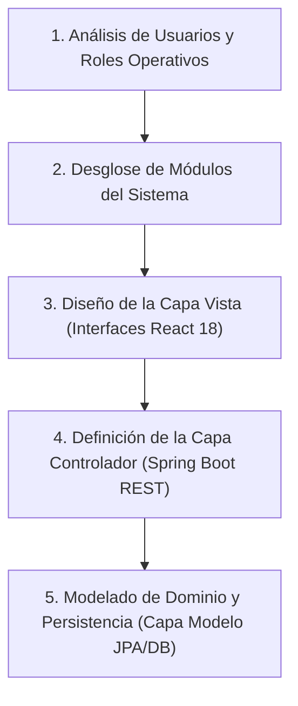
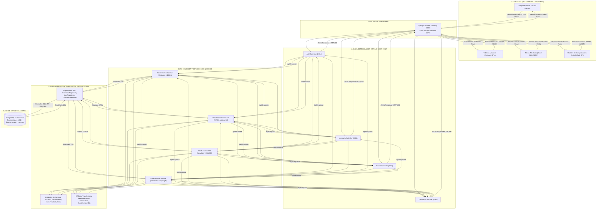
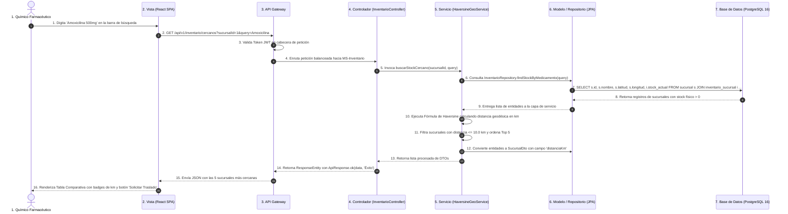
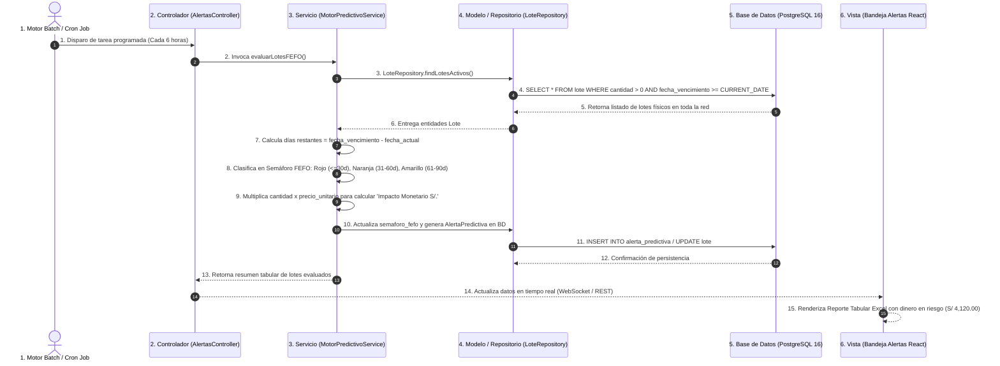
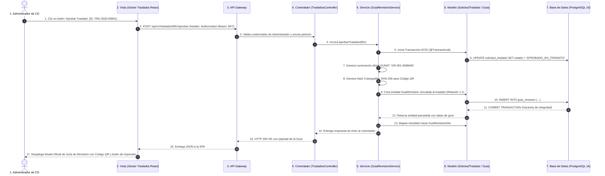

# UNIVERSIDAD TECNOLÓGICA DEL PERÚ
## FACULTAD DE INGENIERÍA DE SISTEMAS E INFORMÁTICA
### CURSO INTEGRADOR I: SISTEMAS SOFTWARE (SECCIÓN 20065)

---

# S09 - TRABAJO DE ARQUITECTURA DE SOFTWARE
## DISEÑO Y ESTRUCTURACIÓN DEL PATRÓN MODELO-VISTA-CONTROLADOR (MVC) Y FLUJOS DE INFORMACIÓN DE INICIO A FIN
### PROYECTO: SISTEMA INTELIGENTE DE INVENTARIO Y PREDICCIÓN (SIIP) - FARMACIAS PERUANAS (INKAFARMA / MIFARMA)

---

| INFORMACIÓN ACADÉMICA | DETALLE |
|---|---|
| **Institución:** | Universidad Tecnológica del Perú (UTP) |
| **Curso:** | Curso Integrador I: Sistemas Software (Sección 20065) |
| **Docente:** | **IRANI GUILLEN GOMEZ** |
| **Estudiante:** | **Mendoza Paucar Ronny Fernando** |
| **Código UTP:** | **U25302314** |
| **Ciclo Académico:** | 5° Semestre - 2026 |
| **Fecha de Entrega:** | 09 de Octubre de 2026 |

---

## 1. INTRODUCCIÓN Y CONTEXTO DEL PROYECTO

### 1.1. Contexto Empresarial
El presente informe técnico desarrolla el diseño arquitectónico del patrón **Modelo-Vista-Controlador (MVC)** enfocado en el **Sistema Inteligente de Inventario y Predicción (SIIP)** para la corporación **Farmacias Peruanas S.A.** (conglomerado líder que opera más de 2,200 puntos de venta a nivel nacional bajo las marcas **InkaFarma** y **Mifarma**).

### 1.2. Justificación del Patrón MVC en Arquitectura de Microservicios
En un entorno farmacéutico con alto volumen transaccional (más de 350 transacciones por segundo en horas punta), el patrón **MVC desacoplado** (Frontend Single Page Application en **React 18** + Backend REST API en **Java 17 Spring Boot 3**) resulta indispensable para:
1. **Separación Estricta de Responsabilidades (SoC):** Desvincular por completo la lógica de presentación visual (interfaz de usuario para químicos farmacéuticos) de la lógica de negocio (algoritmos matemáticos de **Haversine < 10 km** y semáforo **FEFO a 90, 60 y 30 días**) y del acceso a datos relacionales en **PostgreSQL 16**.
2. **Escalabilidad y Mantenibilidad:** Permitir que los controladores y servicios backend escalen elásticamente en microservicios contenerizados (Docker) sin impactar la experiencia del usuario en ventanilla.
3. **Flujo de Información Unidireccional y Trazable:** Garantizar que cada solicitud de stock o aprobación de traslado siga un ciclo de vida predecible con transacciones ACID seguras y respuestas menores a 2.0 segundos.

---

## 2. PROCEDIMIENTOS A SEGUIR PARA LA ESTRUCTURACIÓN DEL MVC DE INICIO A FIN

A continuación, se describen los 5 procedimientos metodológicos ejecutados para concebir y estructurar el patrón MVC del sistema:

---

### 2.1. Procedimiento 1: Análisis de Usuarios y Perfiles de Acceso
Se analizaron los 4 actores principales que generan o consumen información en el flujo MVC:

| Perfil de Usuario | Nivel de Acceso en MVC | Interacción Principal en el Flujo |
|---|---|---|
| **Químico Farmacéutico (Ventanilla)** | Capa Vista (UI React) | Inicia búsquedas de stock geocercano (&lt; 10 km), registra salidas por dispensación y genera solicitudes de traslado de emergencia. |
| **Administrador Centro Distribución (CD)** | Capa Vista / Control | Visualiza la bandeja central de alertas predictivas, autoriza órdenes de balanceo en 1 clic y emite Guías de Remisión SUNAT. |
| **Gerencia de Operaciones y Mermas** | Capa Vista (Analítica) | Monitorea dashboards ejecutivos de KPIs (reducción de mermas al **-22%** y tasa de disponibilidad). |
| **Motor Predictivo / Cron Jobs SIIP** | Capa Servicio (Background) | Proceso automatizado que evalúa el ritmo de ventas diario ($CPD$), proyecta quiebres a 7 días y actualiza semáforos FEFO. |

---

### 2.2. Procedimiento 2: Desglose de Módulos del Sistema
El sistema se organizó en 4 módulos funcionales independientes y un núcleo compartido (*Shared Kernel*):

1. **Módulo de Autenticación y Seguridad (`service-auth`):** Gestión de credenciales, roles RBAC y tokens JWT.
2. **Módulo de Inventario y Geocercanía (`service-inventario`):** Stock centralizado y algoritmo de Haversine (&lt; 10 km).
3. **Módulo de Predicción y Alertas FEFO (`service-prediccion-alertas`):** Cálculo de Consumo Promedio Diario ($CPD$), días de autonomía y semáforo 90/60/30 días.
4. **Módulo de Traslados y Guías SUNAT (`service-traslados`):** Balanceo de sobrestock a quiebres y generación de Guías de Remisión Electrónicas con QR.
5. **Módulo de Dominio Transversal (`shared-kernel`):** DTOs estandarizados, enums de estado (`SemaforoCaducidad`, `EstadoTraslado`) y utilitarios matemáticos.

---

### 2.3. Procedimiento 3: Diseño de la Capa Vista (V - View)
La **Capa Vista** está implementada como una *Single Page Application (SPA)* construida en **React 18 + Vite + Tailwind CSS**, responsable de la interacción visual con el usuario:

* **Componentes de Entrada:** Formularios reactivos con validación local, campos de búsqueda predictiva y selectores de perfiles.
* **Componentes de Visualización:**
  * **Dashboard con Recharts:** Renderizado dinámico de gráficos de barras (*Demanda vs Stock*) y gráficos de dona (*Semáforo FEFO*).
  * **Tablas de Alta Densidad (Excel-Style):** Grids interactivos con paginación, filtros por estado y semáforos visuales (Rojo &lt;30d, Naranja 30-60d, Amarillo 60-90d).
  * **Modal de Guía SUNAT:** Visualización e impresión directa del comprobante electrónico oficial con código QR generado en formato SVG.

---

### 2.4. Procedimiento 4: Definición de la Capa Controlador (C - Controller)
La **Capa Controlador** está programada en **Java 17 Spring Boot 3** bajo la anotación `@RestController`. Actúa como mediador entre la Vista y la Lógica de Negocio:

* **Responsabilidades del Controlador:**
  1. Recibir peticiones HTTP asíncronas (`GET`, `POST`, `PUT`, `DELETE`) enrutadas por el **Spring Cloud API Gateway (Puerto 8080)**.
  2. Validar las cabeceras de autorización y tokens criptográficos JWT (Seguridad RNF-03).
  3. Deserializar los payloads JSON en objetos DTO validados (`@Valid`).
  4. Invocar a la **Capa de Servicios (@Service)** correspondiente.
  5. Empaquetar el resultado en un envelope genérico `ApiResponse<T>` con códigos de estado HTTP estándar (200 OK, 201 Created, 400 Bad Request, 404 Not Found).

#### Tabla de Controladores y Endpoints REST del SIIP

| Controlador Java | Endpoint Base | Método HTTP | Caso de Uso Asociado | Descripción de la Operación |
|---|---|:---:|---|---|
| `AuthController` | `/api/v1/auth/login` | `POST` | CU06: Login | Autentica credenciales y emite token JWT con rol y sede. |
| `InventarioController` | `/api/v1/inventario/cercanos` | `GET` | CU01: Buscador &lt;10km | Triangula las 5 sucursales más cercanas con stock disponible. |
| `AlertasController` | `/api/v1/alertas/vencimientos`| `GET` | CU02: FEFO | Retorna reporte de lotes a 90, 60 y 30 días con impacto en S/. |
| `AlertasController` | `/api/v1/alertas/quiebres` | `GET` | CU02: Quiebres | Retorna fármacos con autonomía &le; 7 días. |
| `TrasladosController` | `/api/v1/traslados/{id}/aprobar`| `POST` | CU03/CU04: Guía SUNAT| Aprueba traslado y emite la Guía de Remisión con código QR. |

---

### 2.5. Procedimiento 5: Modelado de Dominio y Persistencia (M - Model)
La **Capa Modelo** encapsula la estructura de datos del negocio, las reglas de integridad y la interacción con la base de datos **PostgreSQL 16**:

* **Entidades de Dominio (@Entity):** Clases Java que mapean las 11 tablas del esquema relacional en 3FN (`Sucursal`, `Medicamento`, `Lote`, `InventarioSucursal`, `SolicitudTraslado`, `DetalleTraslado`, `GuiaRemision`, `AlertaPredictiva`, `Usuario`, `Rol`).
* **Capa de Lógica de Negocio (@Service):** Clases donde residen los algoritmos propietarios del sistema:
  * `HaversineGeoService`: Cálculo de distancia geodésica $d = 2R \arcsin(\sqrt{\dots})$ en radio &lt; 10 km.
  * `MotorPredictivoService`: Cálculo de Consumo Promedio Diario ($CPD = \frac{\text{Ventas 14 días}}{14}$) y días de autonomía ($\text{Autonomía} = \frac{\text{Stock Actual}}{CPD}$).
  * `GuiaRemisionService`: Generación de código correlativo legal (`GR-001-XXXXXXX`) y hash criptográfico para código QR.
* **Capa de Repositorios (@Repository / Spring Data JPA):** Interfaces que extienden de `JpaRepository<T, ID>` para ejecutar consultas optimizadas con índices B-Tree y PostGIS.

---

## 3. DIAGRAMA ARQUITECTÓNICO DEL PATRÓN MVC EN EL SISTEMA SIIP

El siguiente diagrama ilustra la arquitectura de capas y el acoplamiento desacoplado del patrón MVC:

---

## 4. FLUJO DE LA INFORMACIÓN DE INICIO A FIN (TRANSACCIONES DETALLADAS)

Para cumplir con el requerimiento de explicar detalladamente **de dónde inicia la información, hacia dónde va y hacia dónde termina**, se analizan los 3 flujos transaccionales más representativos del sistema:

---

### 4.1. Flujo 1: Consulta de Inventario Georreferenciado (< 10 km con Haversine)

* **Propósito:** Permitir que el farmacéutico en ventanilla localice stock disponible en las 5 sucursales más cercanas cuando su sede tiene quiebre de stock.

#### Explicación Secuencial del Flujo 1:
1. **Inicio en la Vista (React):** El Químico Farmacéutico ingresa el término de búsqueda. El componente React captura el evento `onChange` y despacha una petición HTTP `GET` asíncrona mediante Axios.
2. **Tránsito por Enrutamiento y Controlador:** El API Gateway valida el token JWT del usuario y enruta la solicitud al `InventarioController` de Spring Boot. El controlador valida los parámetros de entrada y delega la ejecución al `HaversineGeoService`.
3. **Consulta y Persistencia en el Modelo:** El servicio invoca al `InventarioRepository`, el cual ejecuta una consulta SQL indexada sobre PostgreSQL para recuperar las coordenadas GPS (`latitud`, `longitud`) de las sucursales con existencias del producto.
4. **Procesamiento Matemático:** La capa de servicio itera los resultados y aplica la **Fórmula de Haversine**:
   $$d = 2R \cdot \arcsin\left(\sqrt{\sin^2\left(\frac{\Delta \text{lat}}{2}\right) + \cos(\text{lat}_1)\cos(\text{lat}_2)\sin^2\left(\frac{\Delta \text{lon}}{2}\right)}\right)$$
   Filtrando únicamente aquellas boticas a una distancia $d \le 10.0 \text{ km}$.
5. **Término y Renderizado:** Los datos se transforman a `SucursalDto` y retornan en formato JSON. La Vista de React actualiza su estado interno y pinta la **Tabla Comparativa de Sedes Cercanas** con sus tiempos estimados y stock disponible.

---

### 4.2. Flujo 2: Evaluación Predictiva de Caducidades FEFO (Meta: -22% de Mermas)

* **Propósito:** Identificar y clasificar diariamente los lotes farmacéuticos según su fecha de expiración para priorizar su dispensación antes de su vencimiento.

#### Explicación Secuencial del Flujo 2:
1. **Inicio en el Controlador/Timer:** El proceso se dispara automáticamente mediante un Cron Job en Spring Boot o por consulta manual del Administrador de CD en la interfaz web.
2. **Evaluación de Reglas de Negocio en el Servicio:** `MotorPredictivoService` obtiene los lotes activos mediante `LoteRepository`. Para cada lote, calcula los días de vida útil restante y aplica la función utilitaria `FefoEvaluationUtil.clasificarPorDiasRestantes()`:
   * **Rojo Crítico (&le; 30 días):** Bloqueo preventivo y sugerencia de devolución inmediata.
   * **Naranja Alerta (31 a 60 días):** Priorización FEFO en primera fila de dispensación.
   * **Amarillo Atención (61 a 90 días):** Descuento automático cruzado con monedero digital (*Agora*).
3. **Cálculo de Pérdida Financiera:** El modelo calcula el impacto económico en Soles ($S/.$) multiplicando las cajas en riesgo por el precio de venta unitario.
4. **Término en la Vista:** La información se envía a la interfaz gráfica de React, la cual renderiza el **Reporte Tabular de Caducidades** con badges de colores y tarjetas de valorización económica en riesgo.

---

### 4.3. Flujo 3: Aprobación de Traslado y Emisión de Guía de Remisión SUNAT con QR

* **Propósito:** Formalizar el movimiento de stock entre una tienda donante (sobrestock) y una receptora (quiebre), generando el comprobante legal tributario.

#### Explicación Secuencial del Flujo 3:
1. **Inicio en la Vista:** El Administrador de CD revisa la tabla de traslados sugeridos y hace clic en "Aprobar".
2. **Procesamiento Transaccional en el Backend:** El controlador recibe la petición autenticada y delega al `GuiaRemisionService`. Bajo la anotación `@Transactional`, el sistema ejecuta una transacción atómica ACID en PostgreSQL: cambia el estado del traslado a `APROBADO_EN_TRANSITO` y descuenta el stock en la sede donante.
3. **Generación Criptográfica de la Guía SUNAT:** El servicio construye el correlativo legal (`GR-001-0008492`), asigna los datos del transportista y calcula el hash criptográfico del código QR conforme a las especificaciones técnicas de SUNAT.
4. **Término en la Vista:** La respuesta retorna al navegador del usuario, abriendo automáticamente el componente **`GuiaRemisionModal.jsx`**, el cual renderiza el comprobante en formato oficial con código QR y opciones de descarga o impresión en PDF.

---

## 5. CONCLUSIONES Y RECOMENDACIONES

### 5.1. Conclusiones
1. **Alta Cohesión y Bajo Acoplamiento:** La adopción del patrón MVC desacoplado (React 18 + Spring Boot 3 + PostgreSQL 16) permite aislar los cambios en la interfaz visual sin alterar la lógica de negocio ni las entidades de base de datos.
2. **Flujo de Información Seguro y Trazable:** Cada petición que ingresa al sistema cuenta con trazabilidad de punta a punta: validación de seguridad en el Gateway, procesamiento en servicios especializados, persistencia ACID en PostgreSQL y renderizado reactivo en el cliente.
3. **Cumplimiento del Alcance y Objetivos:** La estructuración del MVC respalda operativamente las metas del proyecto: **reducción del 22% de mermas por vencimientos**, geolocalización a menos de 10 km con Haversine y automatización de guías electrónicas SUNAT.

### 5.2. Recomendaciones
1. **Implementación de Caché Distribuida:** Se recomienda incorporar **Redis** en la capa de servicio para almacenar en memoria las coordenadas y datos maestros de medicamentos, reduciendo aún más los tiempos de respuesta por debajo de los 50 milisegundos.
2. **Monitorización con Spring Boot Actuator:** Establecer métricas de telemetría sobre los controladores y repositorios para supervisar en tiempo real los tiempos de ejecución de las consultas a la base de datos.
