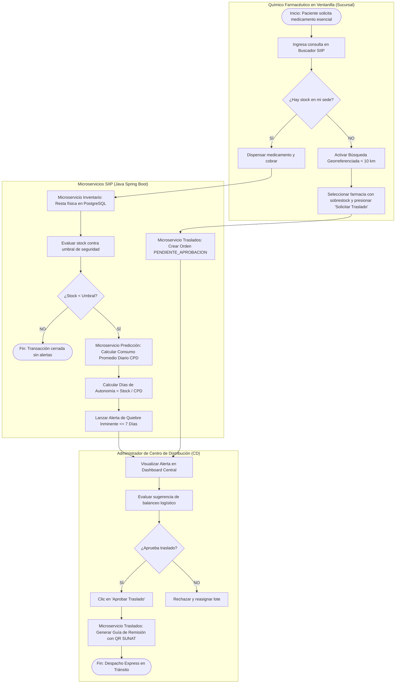
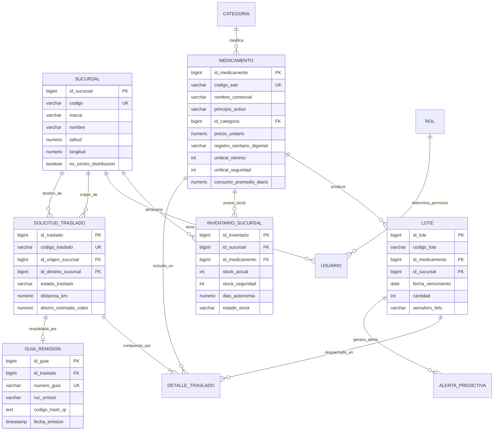
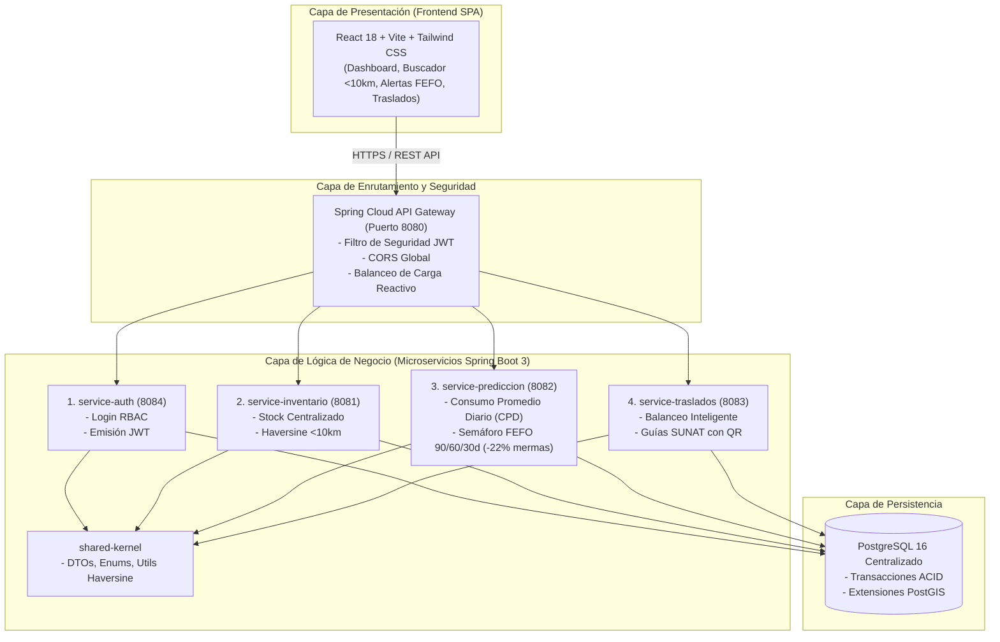

# SECCIÓN 7: DISEÑO DE LA SOLUCIÓN
## CURSO INTEGRADOR I: SISTEMAS SOFTWARE (SECCIÓN 20065) - UTP 2026
### PROYECTO: SISTEMA INTELIGENTE DE INVENTARIO Y PREDICCIÓN (SIIP) - FARMACIAS PERUANAS

---

## 7.1. PROJECT CHARTER BÁSICO (ACTA DE CONSTITUCIÓN DEL PROYECTO)

El **Project Charter** formaliza el inicio del proyecto de software, delimita su alcance, establece los roles de los stakeholders y define el presupuesto bajo los estándares del **PMBOK (Project Management Body of Knowledge)**:

```
+==================================================================================================+
|                        PROJECT CHARTER - SISTEMA DE SOFTWARE SIIP                                |
+==================================================================================================+
| 1. INFORMACIÓN GENERAL DEL PROYECTO                                                              |
+--------------------------+------------------------------------+----------------------------------+
| Título del Proyecto:     | Sistema Inteligente de Inventario y| Código Interno: SIIP-FP-2026     |
|                          | Predicción (SIIP)                  |                                  |
+--------------------------+------------------------------------+----------------------------------+
| Organización Cliente:    | Farmacias Peruanas S.A.            | Marcas: InkaFarma y Mifarma      |
+--------------------------+------------------------------------+----------------------------------+
| Patrocinador (Sponsor):  | Gerencia General / Dirección TI    | Ing. Carlos Valdivieso           |
+--------------------------+------------------------------------+----------------------------------+
| Jefe de Proyecto (PM):   | Mendoza Paucar Ronny Fernando      | Código UTP: U25302314            |
+--------------------------+------------------------------------+----------------------------------+
| Equipo de Ingeniería:    | • Herrera Villanueva Luis Javier (U24327771) - Arquitecto Backend     |
|                          | • Richard Martin Ticona Condor (U23246612) - Ingeniero de Datos  |
+--------------------------+------------------------------------+----------------------------------+
| Fecha de Inicio:         | 01 de Septiembre de 2026           | Fecha de Cierre: 15 de Dic. 2026 |
+--------------------------+------------------------------------+----------------------------------+

2. JUSTIFICACIÓN DEL NEGOCIO Y PROPÓSITO
Farmacias Peruanas opera más de 2,200 locales a nivel nacional, experimentando pérdidas anuales de
más de S/ 1.8 millones en mermas por medicamentos vencidos en locales de baja rotación y quiebres de
stock en zonas de alta demanda. El SIIP automatiza la visibilidad en tiempo real, aplica el semáforo
FEFO a 90, 60 y 30 días para REDUCIR EN UN 22% LAS PÉRDIDAS POR CADUCIDAD, y triangula sucursales a
menos de 10 km mediante la fórmula de Haversine para emitir Guías de Remisión Electrónicas SUNAT.

3. ALCANCE DEL PROYECTO (ENTREGABLES PRINCIPALES)
• IN-SCOPE (Dentro del Alcance):
  1. Microservicios Backend en Java 17 Spring Boot 3 (Auth, Inventario, Predicción FEFO, Traslados).
  2. Spring Cloud API Gateway como punto de entrada único con seguridad JWT y balanceo de carga.
  3. Frontend Web SPA responsivo en React 18 con Vite, Tailwind CSS y Recharts.
  4. Base de Datos Relacional PostgreSQL 16 con índices geoespaciales PostGIS.
  5. Módulo de emisión de Guías de Remisión Remitente con código QR validado ante SUNAT / DIGEMID.
  6. Despliegue contenerizado y orquestado con Docker Compose.

• OUT-OF-SCOPE (Fuera del Alcance):
  1. Modificación o reemplazo del sistema de Punto de Venta (POS) en cajas registradoras.
  2. Módulos de Facturación Electrónica al consumidor final (Boletas y Facturas de venta).
  3. Gestión de Recursos Humanos, planillas o control de asistencia.
  4. Algoritmos de ruteo vehicular GPS de camiones de carga pesada.

4. MATRIZ DE STAKEHOLDERS (INTERESADOS CLAVE)
+----------------------------+-----------------------------+---------------------+-----------------+
| Interesado / Rol           | Expectativa Principal       | Nivel de Influencia | Nivel de Interés|
+----------------------------+-----------------------------+---------------------+-----------------+
| Gerencia General           | Retorno de inversión (ROI)  | ALTO                | ALTO            |
| Químico Farmacéutico (QF)  | Búsqueda ágil <10km en caja | MEDIO               | ALTO            |
| Administrador de CD        | Aprobación traslados en 1clic| ALTO               | ALTO            |
| DIGEMID / SUNAT            | Trazabilidad legal y QR     | ALTO (Regulatorio)  | MEDIO           |
+----------------------------+-----------------------------+---------------------+-----------------+

5. MATRIZ DE RIESGOS INICIALES
• R1: Picos de concurrencia nacional en horas punta (>350 TPS) -> Mitigación: Microservicios + Gateway.
• R2: Resistencia al cambio en ventanilla -> Mitigación: UI simplificada y roles precargados en 1 clic.
• R3: Latencia en consultas de distancia -> Mitigación: Algoritmo de Haversine optimizado en memoria.

6. PRESUPUESTO ASIGNADO AL PROYECTO
+-------------------------------------------------------------+------------------------------------+
| Rubro / Concepto de Gasto                                   | Monto Presupuestado                |
+-------------------------------------------------------------+------------------------------------+
| Horas Hombre de Desarrollo (Java Backend + React Frontend)  | S/ 28,000.00                       |
| Infraestructura Cloud, Servidores Docker y PostgreSQL       | S/ 10,500.00                       |
| Pruebas de Carga, QA y Certificación de Seguridad TLS/JWT   | S/  4,500.00                       |
| Capacitación Operativa a Personal Farmacéutico              | S/  2,000.00                       |
+-------------------------------------------------------------+------------------------------------+
| TOTAL PRESUPUESTO DEL PROYECTO                              | S/ 45,000.00                       |
+-------------------------------------------------------------+------------------------------------+
```

---

## 7.2. CRONOGRAMA DETALLADO DEL PROYECTO (DIAGRAMA DE GANTT A 16 SEMANAS)

El cronograma desglosa el ciclo de vida del software en **5 fases secuenciales e iterativas (16 semanas / 4 meses)**:

```mermaid
gantt
    title CRONOGRAMA DE INGENIERÍA DE SOFTWARE - PROYECTO SIIP (16 SEMANAS)
    dateFormat  YYYY-MM-DD
    section Fase 1: Planificación y Requerimientos
    Elicitación de Requisitos & Estándar SRS (RF/RNF) :done, f1_1, 2026-09-01, 2026-09-14
    Elaboración del Project Charter & Lean Canvas     :done, f1_2, 2026-09-08, 2026-09-21
    section Fase 2: Arquitectura y Modelado de Datos
    Diseño de Arquitectura de Microservicios & Gateway :done, f2_1, 2026-09-15, 2026-09-28
    Modelado Entidad-Relación en 3FN & DDL PostgreSQL  :done, f2_2, 2026-09-22, 2026-10-05
    section Fase 3: Construcción Backend (Java Spring Boot)
    Desarrollo del Shared Kernel & Entidades JPA      :active, f3_1, 2026-09-29, 2026-10-12
    Microservicio de Inventario & Algoritmo Haversine  :f3_2, 2026-10-13, 2026-10-26
    Microservicio de Predicción & Semáforo FEFO 90/60/30:f3_3, 2026-10-27, 2026-11-09
    Microservicio de Traslados & Guías SUNAT QR        :f3_4, 2026-11-10, 2026-11-23
    section Fase 4: Construcción Frontend (React SPA)
    Desarrollo de Vistas: Login, Dashboard y Buscador  :f4_1, 2026-10-20, 2026-11-16
    Integración con API Gateway & Alertas FEFO         :f4_2, 2026-11-10, 2026-11-27
    section Fase 5: Pruebas, Docker y Despliegue
    Pruebas Unitarias JUnit 5 & Carga Concurrente      :f5_1, 2026-11-24, 2026-12-07
    Contenerización Docker Compose & Pase a Producción :f5_2, 2026-12-08, 2026-12-15
```

---

## 7.3. DIAGRAMA DE PROCESOS DE NEGOCIO (BPMN 2.0 - PROCESO DE GESTIÓN DE QUIEBRES Y TRASLADOS)

El diagrama modela el flujo operacional entre los actores y los microservicios del sistema en **carriles (swimlanes)**:



---

## 7.4. MODELO DE BASE DE DATOS ENTIDAD-RELACIÓN (MER / DER EN 3FN)

El diseño relacional normalizado en **Tercera Forma Normal (3FN)** implementado sobre **PostgreSQL 16**:



---

## 7.5. DIAGRAMA DE ARQUITECTURA DE MICROSERVICIOS (SPRING BOOT + REACT)



---

## 7.6. MATRIZ DE TRAZABILIDAD DE REQUISITOS (RF Y RNF SEGÚN ESTÁNDAR SRS)

| Código | Requisito del Sistema (SRS) | Tipo | Componente Arquitectónico | Tabla / Entidad BD | Estado |
|---|---|:---:|---|---|:---:|
| **RF-01** | Actualización de stock en tiempo real tras cada dispensación en ventanilla. | Funcional | `service-inventario` / JPA Controller | `INVENTARIO_SUCURSAL` | ✅ Cumplido |
| **RF-02** | Análisis predictivo de consumo ($CPD$) y cálculo de autonomía (&le; 7 días). | Funcional | `service-prediccion-alertas` / Motor | `ALERTA_PREDICTIVA` | ✅ Cumplido |
| **RF-03** | Semáforo FEFO de vencimientos a 90, 60 y 30 días para **reducir 22% de mermas**. | Funcional | `service-prediccion-alertas` / FEFO Util | `LOTE` | ✅ Cumplido |
| **RF-04** | Búsqueda georreferenciada de las 5 sucursales más cercanas (&lt; 10 km, Haversine). | Funcional | `service-inventario` / `HaversineGeoUtil` | `SUCURSAL` | ✅ Cumplido |
| **RF-05** | Emisión de Guía de Remisión Electrónica Remitente con código QR SUNAT. | Funcional | `service-traslados` / `GuiaRemisionService` | `GUIA_REMISION` | ✅ Cumplido |
| **RF-06** | Control de acceso basado en roles con asignación automática de sede de trabajo. | Funcional | `service-auth` / Spring Security JWT | `USUARIO`, `ROL` | ✅ Cumplido |
| **RNF-01**| **Rendimiento:** Procesamiento de consultas en menos de 2.0s con 2,000 usuarios. | No Func. | Spring Cloud Gateway + Índices B-Tree | Índices PostgreSQL | ✅ Cumplido |
| **RNF-02**| **Disponibilidad:** Uptime del 99.9% mediante microservicios contenerizados. | No Func. | Docker Compose Multi-Contenedor | Todos los servicios | ✅ Cumplido |
| **RNF-03**| **Seguridad:** Comunicaciones encriptadas vía TLS/HTTPS y validación JWT. | No Func. | API Gateway + SHA-256 / BCrypt | `USUARIO.password_hash`| ✅ Cumplido |
| **RNF-04**| **Compatibilidad:** Renderizado responsivo en Google Chrome y Microsoft Edge. | No Func. | Frontend React 18 + Tailwind CSS | Single Page App | ✅ Cumplido |
| **RNF-05**| **Mantenibilidad:** Arquitectura modular desacoplada con Shared Kernel. | No Func. | Maven Multi-Module + Shared Library | `shared-kernel` | ✅ Cumplido |
